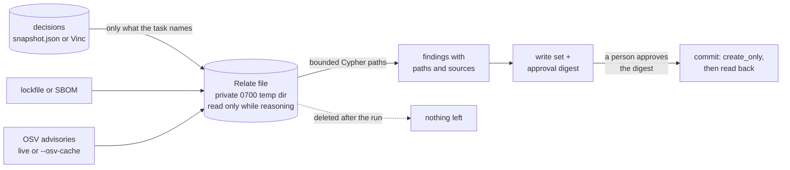

<p align="center">
  
</p>

# decisis

**Check work against the decisions your team already made, in a throwaway graph, offline.**

[](https://github.com/Vinculums/decisis/actions/workflows/test.yml)
[](https://pypi.org/project/decisis/)
[](https://pypi.org/project/decisis/)
[](https://github.com/Vinculums/decisis/blob/main/LICENSE)
[](https://github.com/relatedb/relate)


decisis (from *stare decisis*, "stand by what was decided") is a command-line tool and Python package.
It takes the decisions a task needs, joins them with code paths and outside facts (a lockfile or SBOM and
OSV advisories) in a throwaway [Relate](https://github.com/relatedb/relate) graph, and finds the
multi-hop path from a decision to the thing that breaks it. Every finding carries that path and its
sources. The graph lives in a private temporary directory and is deleted when the task ends.

It needs no account and no model. Decisions come from a plain JSON snapshot that you can write by hand,
or from a [Vinc](https://vincs.io) space if you connect one. Nothing is written back anywhere unless a
person approves the exact write set by its digest.

What it is not, today: a linter that reads your code, a vulnerability scanner for every ecosystem, or a
place to store decisions. It reads the lockfiles and SBOMs listed under [Inventory formats](#inventory-formats), decisions come from a snapshot file or Vinc, and
the benchmark below is small and synthetic. [What is proven, and what is not built yet](#what-is-proven-and-what-is-not-built-yet)
has the full list.

## Install

Python 3.11 or newer on macOS, Linux or Windows (x86-64; arm64 on macOS and Linux).

```bash
pip install decisis
```

As an isolated command-line tool:

```bash
uv tool install decisis      # or: pipx install decisis
```

The install fetches `relate-db` and `PyYAML` from PyPI once; every command after it runs offline, except `audit`
asking api.osv.dev when you give it no `--osv-cache`. The [npm package](https://www.npmjs.com/package/decisis)
only points here.

## Quick start

**1. Watch the whole procedure on synthetic data** (under a second, writes nothing):

```bash
decisis demo
```

It checks out 3 of 9 nodes from a synthetic team graph, joins them with a lockfile and cached OSV
advisories in a Relate graph (14 nodes, 15 edges), finds the five-hop path below, has a Checker
re-derive each proposed record (31 checks over 7 records), and stops at the write set and its digest:

```
decision:no-high-advisories-in-shipped-dependencies -ABOUT-> concept:demo-app <-DESCRIBED_BY- repo:Demo
  -DEPENDS_ON-> pkg:npm/report-kit@2.1.0 -DEPENDS_ON-> pkg:npm/lodash@4.17.15 -AFFECTED_BY-> adv:GHSA-r5fr-rjxr-66jc
```

The rule lives in the team's decisions, the dependency chain in the lockfile and the advisory in OSV;
no single source holds the connection.

**2. Use your own decisions.** If the repository keeps ADRs (MADR or Nygard), a CODEOWNERS file or
postmortems, build the snapshot from them and ask what governs a file:

```bash
decisis init --repo-dir . --repo Shop --out snapshot.json
decisis impact snapshot.json src/payments/retry.py --repo Shop --format text
```

To add decisions made in pull requests, give `init` the GitHub repository. It reads merged pull requests
that carry the `decision` label (or `--label NAME`) or a `## Decision` section, through the GitHub REST API
with `GITHUB_TOKEN` when it is set (a public repository needs no token), and merges them with the files:

```bash
decisis init --repo-dir . --repo Shop --github acme/shop --since 2026-01-01 --out snapshot.json
```

`init` prints what it could not read and why; [`docs/data-model.md`](https://github.com/Vinculums/decisis/blob/main/docs/data-model.md#a-snapshot-from-a-repository-init)
lists the front matter keys and headings it reads. Or write a snapshot by hand: one JSON file of nodes and edges. This one has an app,
a checkout flow, one decision and one incident record ([`docs/data-model.md`](https://github.com/Vinculums/decisis/blob/main/docs/data-model.md) has
every field):

```json
{
 "nodes": [
  {"id": "concept:shop-web", "kind": "concept", "title": "Shop web app", "props": {"code_ref": "Shop:src/"}},
  {"id": "concept:checkout-flow", "kind": "concept", "title": "Checkout flow", "props": {"code_ref": "Shop:src/checkout/"}},
  {"id": "decision:no-high-advisories-when-shipped", "kind": "decision", "title": "No high advisories in what we ship",
   "props": {"rule": {"advisory_severity_at_least": "HIGH", "dependencies": "shipped"}}},
  {"id": "record:checkout-timeout-october", "kind": "record", "title": "Checkout timed out under load"}
 ],
 "edges": [
  {"source": "decision:no-high-advisories-when-shipped", "target": "concept:shop-web", "type": "ABOUT", "evidence": "applies to the whole app"},
  {"source": "concept:checkout-flow", "target": "concept:shop-web", "type": "RELATED_TO", "evidence": "part of the app"},
  {"source": "record:checkout-timeout-october", "target": "concept:checkout-flow", "type": "RELATED_TO", "evidence": "the timeout was in this flow"}
 ]
}
```

**3. Ask what governs a file before you change it:**

```
$ decisis impact my-snapshot.json src/checkout/pay.py --format text
src/checkout/pay.py: 4 node(s) within 3 hop(s)
  [0] concept  concept:checkout-flow  code_ref Shop:src/checkout/ (encloses)
  [0] concept  concept:shop-web  code_ref Shop:src/ (encloses)
  [1] decision decision:no-high-advisories-when-shipped  via concept:shop-web
        decision:no-high-advisories-when-shipped -ABOUT-> concept:shop-web  (applies to the whole app)
  [1] record   record:checkout-timeout-october  via concept:checkout-flow
        record:checkout-timeout-october -RELATED_TO-> concept:checkout-flow  (the timeout was in this flow)
```

**4. Check a change against the review and import rules of those decisions.** A decision's `rule` can
name the reviewers a path needs (`review_required`) and the imports one part of the code must not make
(`imports_forbidden`). `check` lists the decisions that govern each changed file, judges both kinds, and
exits 1 when a rule is violated:

```
$ decisis check fixtures/check/vinc.json --repo-dir fixtures/check/repo --changed src/shop/ui/view.py src/payments/charge.py --reviewers @bob --format text
2 changed file(s); reviewers: @bob
governing decisions: 2
  decision:payments-need-a-payments-review  Payment changes need a review from the payments team  (src/payments/charge.py)
  decision:ui-does-not-import-db  The user interface reads data through the API, never the database layer  (src/shop/ui/view.py)
superseded, not judged:
  decision:payments-reviewed-by-carol  superseded by decision:payments-need-a-payments-review
rules that cover a changed file: 2
violations: 3
  src/payments/charge.py  decision:payments-need-a-payments-review  review_required: src/payments/** needs a review from @alice or @shop/payments; none of them is among the reviewers given
  src/shop/ui/view.py:4  decision:ui-does-not-import-db  imports_forbidden: src/shop/ui/** must not import src/shop/db/**; from shop.db import models is src/shop/db/models.py
  src/shop/ui/view.py:5  decision:ui-does-not-import-db  imports_forbidden: src/shop/ui/** must not import src/shop/db/**; from ..db.session import open_session is src/shop/db/session.py
cannot be judged: 1
  src/shop/ui/view.py:10  decision:ui-does-not-import-db  imports_forbidden: import_module() with a computed name: the specifier is computed at run time; it cannot be judged
```

In CI, give it the base branch instead of a file list: `decisis check snapshot.json --base origin/main
--reviewers @alice`. It reads the changed files with `git diff --name-only origin/main...HEAD`, with the
repository's hooks, fsmonitor and pager turned off. Imports are parsed, never run: Python with `ast`,
JavaScript and TypeScript with a scanner that skips comments and strings. An import whose target is
computed at run time, or that the scanner and a plain text search read differently, is listed as
`unresolved`, not as a violation; add `--fail-on-unresolved` to make those fail the check too. The rule format, the glob rules and
the JSON report are in [`docs/data-model.md`](https://github.com/Vinculums/decisis/blob/main/docs/data-model.md#the-check-report).

**5. Audit a lockfile against those decisions:**

```bash
decisis audit my-snapshot.json package-lock.json --repo Shop --out report.json
```

`report.json` lists each advisory the repository reaches, the dependency path to it, and the decisions
it breaks. With the demo lockfile and its cached advisories, three findings on shipped `lodash` break the
decision above.

### Inventory formats

`audit` tells the format from the file's content and name:

| Format | File | Development dependencies |
|---|---|---|
| npm lockfile v2 or v3 | `package-lock.json`, `npm-shrinkwrap.json` | `dev` in the lockfile |
| CycloneDX JSON 1.4, 1.5, 1.6 | any name | a component with scope `excluded` or `cdx:npm:package:development` |
| SPDX JSON 2.3 | any name | `DEV_DEPENDENCY_OF`, `TEST_DEPENDENCY_OF`, `BUILD_DEPENDENCY_OF`, `DEV_TOOL_OF` |
| uv | `uv.lock` | dependency groups (`dev-dependencies`) |
| Cargo | `Cargo.lock` | not marked in the lockfile; every crate counts as shipped |
| Go modules | `go.mod`, with `go.sum` in the same directory | not marked; every module counts as shipped |
| Gradle lockfile | `gradle.lockfile`, `settings-gradle.lockfile` | every configuration that locks it is a test, compile-only or annotation processor one |
| Maven POM | `pom.xml` | scope `test` or `provided` |
| Poetry, lock-version 1.x and 2.x | `poetry.lock`, with `pyproject.toml` in the same directory when present | `category = "dev"` (1.x), `groups` without `main` (2.1), or the non-main groups in `pyproject.toml` |
| pip requirements | `requirements*.txt` | not marked; every package counts as shipped |
| pnpm lockfile v6 or v9 | `pnpm-lock.yaml` | an importer's `devDependencies`; v6 also `dev: true` |
| Yarn v1 and Yarn Berry (2 and later) | `yarn.lock`, with the root `package.json` and the workspaces' `package.json` files next to it | `devDependencies` in the `package.json` files |
| Bun text lockfile | `bun.lock` | a workspace's `devDependencies` |
| GitHub Actions workflows | any `.github/workflows/*.yml` (the other workflows beside it are read too), or an `action.yml` | not marked; every action counts as shipped |
| Terraform lock file | `.terraform.lock.hcl` | not marked; every provider counts as shipped |

For Go, pass `go.mod`; `audit` reads the `go.sum` next to it and stops when a required module has no
line there. In a pnpm, Yarn or Bun monorepo each workspace package (a pnpm importer, a Yarn or Bun
workspace) is a `Workspace` node between the repository and its dependencies, so a path reads
`repo:<name> -> workspace:<name>:<path> -> pkg:npm/... -> pkg:npm/...`; the root package's dependencies hang
from the repository. Peer and optional dependencies are edges with `(peer)` or `(optional)` in the evidence.
For `yarn.lock`, `audit` reads the root `package.json` and the `package.json` of each directory its
`workspaces` globs match; without them the packages are linked straight from the repository. A binary
`bun.lockb` is refused: run `bun install --save-text-lockfile` and audit the `bun.lock` it writes. Each package is queried at OSV under its own ecosystem (npm, PyPI, crates.io, Go, Maven, GitHub Actions, and for
SBOMs also NuGet, RubyGems, Packagist, GitHub Actions, Debian and Alpine). An SBOM component
without a purl, or whose purl type has no OSV ecosystem, stays in the graph and is listed under
`unresolved_packages` in the report; it is not queried. An inventory with no packages, or none that can
be queried, is refused. `fixtures/inventory/` holds one small example of each format and an OSV cache
that covers them all; the Gradle and Maven examples and their cache are in `fixtures/inventory/jvm/`, and the
workflows and Terraform lock file with theirs in `fixtures/inventory/ci/`.

A Gradle lockfile pins every resolved version but not which dependency brings in which, and a `pom.xml`
declares direct dependencies only. `audit` reads `pom.xml` versions that are literals or properties
defined in the same file, and lists a version from a parent, an imported BOM, a range, `LATEST` or
`RELEASE`, or a missing one under `unresolved_packages`. For both formats the report carries `notes`
saying that transitive dependencies are not resolved. For the full graph, generate CycloneDX JSON with
`cyclonedx-gradle-plugin` or `cyclonedx-maven-plugin` and audit that instead; the HTML view shows the
notes above the findings.

For Poetry, a `poetry.lock` that marks no package as development and has no `pyproject.toml` next to it
is read with every package shipped, and the report says the dev split is unknown. A requirements file
gives packages only for `name==version` pins; every other line (a range, no version, a URL) is listed
under `unresolved_packages` with the line and the reason, and no version is guessed. `-r` includes are
followed only inside the repository, and each file is read once. A requirements file
lists direct dependencies only, so the report says the packages they depend on were not seen and
recommends a lockfile or an SBOM. Such notes are in the report's `inventory_notes`. Python names are
normalized as in PEP 503 and queried under the PyPI ecosystem.

For GitHub Actions, pass one workflow file, such as `.github/workflows/ci.yml`; `audit` also reads every
other `*.yml` and `*.yaml` workflow in the same directory through the same bounded reader as other
sibling files (`serve --mcp` reads only the file it is given). Each `uses:` of a step, and of a job that
calls a reusable workflow, becomes a package in the OSV `GitHub Actions` ecosystem named `owner/repo`
(`owner/repo/path@ref` too) in lower case, since GitHub does not tell case apart, with its ref as written:
a tag, a branch or a commit SHA. OSV does tell case apart and stores some names in mixed case
(`Azure/setup-kubectl`), so when the inventory has actions `audit` also downloads OSV's own list of
GitHub Actions records, `https://osv-vulnerabilities.storage.googleapis.com/GitHub%20Actions/all.zip`
(once per run, at most 64 MiB), and asks OSV for each action under the spelling OSV stores; an action
that is not in that list has no advisories and is not queried. `--osv-cache` carries that list as
`names`, and a cached run with actions refuses without it. A local `./` action, a `docker://` image, a `uses:` built from an
expression and one that is not a name (`../x@v1`) are listed under `unresolved_packages` with the reason
and not queried, and so is a workflow file that is not valid YAML or cannot be read (not UTF-8, or a link
that leads outside the repository). YAML anchors and aliases are
allowed in workflows, up to 100,000 expanded nodes. OSV does not match GitHub Actions versions itself, so
`audit` asks OSV for every advisory of each action and compares the ref with the ranges: a tag such as
`v4.1.0` is a version, a major or minor tag such as `v4` covers every release under it and is `unresolved`
when a range starts or ends inside it, and a branch or a commit SHA cannot be ordered, so its advisories
are `unresolved` unless the record lists that ref. An `action.yml` is read for the `uses:` of its
composite `runs.steps`.

A `.terraform.lock.hcl` is read by a small strict parser: `provider "<address>" { ... }` blocks with
quoted strings and lists of quoted strings, and comments; anything else stops the run with the line.
Each provider is a package in the ecosystem `Terraform` with its full address as the name and its locked
version. OSV has no Terraform ecosystem (checked 2026-11-24), so providers are not queried: they are
checked against decision rules only (`package_denied`, `package_allowed`), each is listed under
`unresolved_packages` with that reason, and `inventory_notes` says so.

Files next to the inventory (`go.sum`, `pyproject.toml`, `-r` includes, the `package.json` files of Yarn
workspaces) are read only inside the repository: the nearest directory above the inventory that holds a
`.git` entry, found without running git, or the inventory's own directory when there is none. `--root DIR` sets it. Paths that lead outside,
symbolic links included, are not read. Includes are followed 64 levels deep, and a leading UTF-8 byte order
mark is dropped from every file.

## How it works



1. **Check out** only the slice of decisions a task names: a snapshot file, or `checkout` from Vinc.
2. **Load** it with the outside facts into a fresh Relate file in a private directory (under `/dev/shm`
   when it is writable). The loader checks that every node and edge landed.
3. **Reason** read only with bounded Cypher queries (`src/decisis/queries/*.cypher`), so every answer is
   a path you can follow edge by edge.
4. **Propose and approve.** `propose` turns findings into records, re-derives each one in a fresh graph
   built from the snapshot, the lockfile and OSV, holds back any record that fails, and prints the exact
   write set with a digest. Nothing is written until a person passes that digest to `commit`, which
   writes with `create_only` and reads every node and edge back.
5. **Delete** the graph when the task ends.

## Commands

| Command | Needs | What it does |
|---|---|---|
| `demo` | nothing | the whole procedure on synthetic data, against an in-process fake Vinc |
| `init --out <file>` | nothing; with `--github`, the network for api.github.com | a snapshot from the repository's ADRs, CODEOWNERS and postmortems, and its merged pull requests |
| `impact <snapshot> <code path>...` | nothing | the decisions and records that govern a file or directory |
| `check <snapshot> (--changed <file>... \| --base <ref>)` | nothing; with `--base`, git | the decisions that govern a change set, and the `review_required` and `imports_forbidden` rules it breaks; exits 1 on a violation |
| `paths <snapshot> <from> <to>` | nothing | bounded paths between two ids |
| `query <snapshot> <cypher> [--param KEY=VALUE]` | nothing | one read-only Cypher statement on a throwaway graph of the snapshot, rows as JSON |
| `audit <snapshot> <lockfile or SBOM> --repo <name>` | the network for api.osv.dev (and OSV's GitHub Actions export for workflows), unless `--osv-cache` | advisories the repository reaches and the decisions they break |
| `propose <report> <snapshot> <lockfile or SBOM> --repo <name> --space <space>` | the network for api.osv.dev, unless `--osv-cache` | re-derives each record, holds back any that fail, and prints the exact write set and its approval digest |
| `compare` | nothing | the benchmark below |
| `checkout <seed>... --out <file>` | a read-only Vinc key | exports a bounded subgraph from Vinc |
| `commit <plan> --approve <digest>` | a full Vinc key | writes an approved write set and reads it back |
| `gc` | nothing | removes task directories that a killed run left behind, and prints them |

Useful flags: `init --repo-dir DIR --repo NAME --adr-dir DIR`, `init --github OWNER/REPO --label NAME --since DATE --limit N`, `impact --hops N --format text`, `check --repo-dir DIR --reviewers HANDLE... --fail-on-unresolved --format text`, `paths --hops N --limit N`,
`audit --osv-cache FILE --depth N`, `propose --osv-cache FILE --depth N` (give `propose` the same inputs and depth as the audit).

Limits: `paths`, `impact`, `check`, `audit`, `query` and `propose` refuse a graph over 50,000 nodes or 250,000 edges before writing
anything, and stop any query that runs longer than 60 seconds; the task directory is removed either way
and the command exits with 1. Raise a limit with `--max-nodes`, `--max-edges` or `--query-timeout`, or with
`DECISIS_MAX_NODES`, `DECISIS_MAX_EDGES` or `DECISIS_QUERY_TIMEOUT`, up to 1,000,000 nodes, 5,000,000 edges
and 3,600 seconds. `audit --depth` and `propose --depth` are 1 to 16, `paths --hops` 1 to 6 and `paths --limit`
1 to 100.
`impact`, `check`, `paths`, `audit` and `query` print JSON (`impact --format text` and `check --format text` read better for people); `demo`, `propose`
and `compare` print text. `decisis <command> --help` lists the rest.

`impact`, `check`, `paths` and `audit` also take `--format mermaid` and `--format html`:

- `impact --format mermaid` prints a fenced Mermaid block that GitHub draws: each code path, the nodes
  that name it and the edges to what governs them. `--format html` prints one page with each node, its
  edge path and the evidence on each edge.
- `check --format mermaid` draws what `impact` draws for each changed file, and marks each violation in red:
  the forbidden import from the file to its target, or the file to the decision whose review it lacks.
  `--format html` lists the violations, the imports that cannot be judged, the governing and superseded
  decisions, and every import read with its resolution.
- `paths --format mermaid` draws each path between the two ids; `--format html` lists each step with the
  evidence the snapshot gives for its edge, and each node's title and `source` when it has one.
- `audit --format mermaid` draws the dependency paths to each advisory and marks the ones that break a
  decision in red; `--format html` lists each finding with its path, its policies and a link to its OSV
  source. With `--out report.json` the JSON report still goes to that file and the view to stdout.

The HTML page is one file with inline styles only: no scripts, fonts or network requests, so it opens
offline. Its only links are the sources of the findings.

Try them on the fixtures in this repository:

```
decisis paths fixtures/vinc_subgraph.json record:tls-advisory-example concept:service-api
decisis impact fixtures/impact/vinc.json reports/export.py storage/ --format text
decisis check fixtures/check/vinc.json --repo-dir fixtures/check/repo --changed src/shop/ui/view.py web/src/ui/page.ts --format html > check.html
decisis audit fixtures/audit/vinc.json fixtures/audit/demo-lockfile.json --repo Demo --osv-cache fixtures/audit/osv-cache.json --out report.json --format html > audit.html
decisis propose report.json fixtures/audit/vinc.json fixtures/audit/demo-lockfile.json --repo Demo --space demo-space --osv-cache fixtures/audit/osv-cache.json --out plan.json
```

## Use it as a GitHub Action

`action.yml` at the root of this repository is a composite action. On a pull request it installs decisis,
reads a snapshot (or builds one with `init: true`), runs `check` on the files the pull request changes and
`audit` when you give an inventory, and keeps one comment on the pull request up to date: the decisions the
change touches, the violations, and a Mermaid path graph. The action is not on the Marketplace; refer to it
by repository and commit.

```yaml
name: decisis
on:
  pull_request:
permissions: {}
concurrency:
  group: decisis-${{ github.event.pull_request.number }}
  cancel-in-progress: true
jobs:
  decisis:
    runs-on: ubuntu-latest
    permissions:
      contents: read
      pull-requests: write
    steps:
      - uses: actions/checkout@3d3c42e5aac5ba805825da76410c181273ba90b1 # v7.0.1
        with:
          fetch-depth: 0
          persist-credentials: false
      - uses: Vinculums/decisis@<commit SHA>
        with:
          snapshot: decisions.json        # or init: true
          inventory: package-lock.json    # optional: also run audit
          fail-on-violation: false
```

| Input | Default | What it does |
|---|---|---|
| `snapshot` | none | a snapshot file, relative to the workspace; give this or `init` |
| `init` | `false` | `true` builds the snapshot from the repository's ADRs, CODEOWNERS and postmortems |
| `github-token` | `github.token` | reads the reviews and writes the comment |
| `inventory` | none | a lockfile or SBOM; when given, `audit` runs too (with `osv-cache`, offline) |
| `fail-on-violation` | `false` | `true` fails the step when `check` or `audit` finds a violation, after the comment is written |
| `decisis-version` | the action's own checkout | a version to install from PyPI instead |
| `repo`, `working-directory`, `osv-cache`, `comment-author`, `python-version` | | see `action.yml` |

- The changed files are `git diff BASE...HEAD`, with the base commit from the event payload. Check out with
  `fetch-depth: 0`; on a shallow checkout the action fetches the history it needs.
- The reviewers that count for `review_required` are the users other than the author whose latest review
  approves the pull request; past 1,000 reviews the rest are not read, and the comment says so. Requested reviewers and teams are listed in the comment and do not count until they approve; a
  team handle in a rule matches only a team handle, so an approval by a team member does not satisfy it.
- The action needs only `contents: read` and `pull-requests: write`. Inputs reach Python as environment
  variables, never through `${{ }}` in a shell script, and Python runs with `-I`, so a module in the pull
  request's checkout cannot shadow decisis. Every title, path and reason in the comment is escaped, and
  mentions are broken so a title cannot notify anyone.
- On a pull request from a fork the token is read-only: the result goes to the job summary instead of a
  comment. The job summary always holds a copy.
- A pull request is a fork when its head repository is not the base repository; a pull request inside a
  repository that is itself a fork still gets a comment.
- Keep the `concurrency` block, so two runs on one pull request cannot both create a comment. Past 3,000
  comments on a pull request the action stops looking for its own and writes only the job summary.
- The comment stays under GitHub's 65,536-character limit: the graph is left out first, then the lists
  are cut, and the comment says what was cut.
- The outputs `violations` and `comment-url` are set for later steps.

`.github/workflows/decisis.yml` runs the action from this checkout on this repository's own pull requests,
with `fixtures/action/vinc.json` (synthetic decisions about decisis's own files) and the audit fixtures.

## Use it from an AI agent

[`skills/decisis/SKILL.md`](https://github.com/Vinculums/decisis/blob/main/skills/decisis/SKILL.md) is a skill for a coding agent such as Claude Code. It
covers when to reach for `audit`, `impact` or `paths`, how to check out only what the task names, how to
read a finding, and the rule that the agent shows the write set and digest to the person and stops. The
agent never approves its own write. To use it, copy the directory to where your agent loads skills (for
Claude Code, `.claude/skills/decisis/`) and put `decisis` on the agent's `PATH`.

decisis itself calls no language model. The agent is the reasoner that chooses seeds, runs the bounded
queries and explains the paths; the tool gives it a graph it cannot write to, findings that carry their
evidence, and a write path that needs a person's digest.

### Serve it over MCP

`decisis serve --mcp` gives an agent the same `impact`, `paths`, `audit` and `query` as MCP tools over stdio, on
one snapshot fixed when the server starts. It needs the optional `mcp` extra; the base install keeps
`relate-db` and `PyYAML` as its only dependencies. For Claude Code:

```
pip install "decisis[mcp]"
claude mcp add decisis -- decisis serve --mcp --snapshot snapshot.json --osv-cache osv-cache.json
```

`claude mcp add --scope project ...` writes the same entry to `.mcp.json` in the project, to share it
with the team:

```json
{
  "mcpServers": {
    "decisis": {
      "command": "decisis",
      "args": ["serve", "--mcp", "--snapshot", "snapshot.json", "--osv-cache", "osv-cache.json"]
    }
  }
}
```

Relative paths are read from the directory the server starts in; use absolute paths if you are not sure
which one that is. The server has no tool that writes, proposes or commits. The tools take the same
bounds as the commands (`hops` 0 to 6 for `impact`, 1 to 6 for `paths`, `limit` 1 to 100; `audit` takes
`depth` 1 to 16), refuse a code path outside the repository, and build and delete a sandbox for each call.
`audit` takes the lockfile path as an argument and reads it only under `--root` (default: the current
directory), after following symlinks. It reads advisories from `--osv-cache`; without a cache it asks
api.osv.dev only when the server was started with `--allow-network`, and otherwise returns an error.

Each tool takes `detail`: `"summary"`, the default over MCP, gives counts, ids, titles and the first 10
items of each list with a note on how to get the rest; `"full"` gives the whole report, the same JSON the
command prints. The commands always print the whole report.

#### When to use `query` and when the fixed tools

Ask the fixed tools first. `impact` answers which decisions and records govern a code path, and follows
only the edges that carry governance, in their governing direction; `paths` lists the routes between two
ids; `audit` joins a lockfile and advisories with the snapshot and judges each decision's rule. Their
answers carry the evidence on each edge, and the same question gets the same report every time.

Use `query` for a question they do not answer: which decisions have no `ABOUT` edge, how many records
each concept has, which nodes name a field, a path that must pass through a given kind. It runs one
read-only Cypher statement on a fresh sandbox of the server's snapshot and returns the rows:

```
decisis query fixtures/impact/vinc.json 'MATCH p = (g)-[*1..3]->(c) WHERE c.code_ref CONTAINS $path AND (g:Decision OR g:Record) RETURN DISTINCT g.id AS id ORDER BY id' --param path=storage/page_store.py
```

The tool's description carries the snapshot's schema, made when the server starts: each label (a node
kind with the first letter in upper case) with its count and property keys, each edge type with its
count and the labels it joins, and two example queries. A query must be one statement that starts with
`MATCH`, `OPTIONAL MATCH`, `WITH`, `UNWIND`, `RETURN` or `CALL`. The text is checked before anything
runs: `CREATE`, `MERGE`, `SET`, `DELETE`, `REMOVE`, `FOREACH`, `LOAD CSV`, `DROP`, `SHOW`, `USE` and the
other admin clauses are refused in any case, after comments and inside subqueries, and only the
`db.labels`, `db.relationshipTypes`, `db.propertyKeys` and `db.schema.*` procedures may be called. Clause
words inside strings, comments and backticked names do not count; a label, type or key named like a clause
goes in backticks. Relate plans every `CALL { }` subquery as read-write, so those are refused too; use
`COLLECT { }`, `COUNT { }`, `EXISTS { }` or `UNION`. Then the query process plans the statement with
`EXPLAIN` on a read-only connection and runs it only when Relate plans it as a read, and the read-only
connection refuses any write on its own. Results stop at 500 rows and 1 MiB with a note that says how many
rows there were, and every MCP reply, as the server sends it, stays under 1 MiB: in full detail the
longest list is shortened and a `cut` note says so. The schema names come from the snapshot: names that
are not plain ASCII identifiers are shown in backticks, and long or unprintable ones are left out.
The node, edge and time limits are the ones above. Nodes, edges and paths come back as
labels or type and properties; return ids and properties to keep the rows small.

## Connect Vinc (optional)

```
VINC_API_KEY=<read-only key> VINC_SPACE=<space id> decisis checkout <seed id> ... --out snapshot.json
VINC_API_KEY=<full key> decisis commit plan.json --approve <digest>
```

`VINC_MCP_URL` points at another Vinc server. Without `VINC_SPACE`, `checkout` reads the key's default
space, and the snapshot's `meta.space` says `personal`. Write to a real space only after its owner
approves the printed write set.

## Does the graph help? The measured comparison

```
decisis compare
```

`compare` runs nine tasks from `bench/tasks.json` three ways, offline and without a model:
**A** answers from the Vinc snapshot alone (nodes whose `code_ref`, `subject_path` or `also_touches` matches the
subject, then one hop; a matching decision or record is reported itself, as `impact` reports it at zero hops);
**B** adds the lockfile and the advisories as flat records joined by package name, with the same version
range check and policy rule as C; **C** loads all three into a Relate graph and queries it. The tasks and
their expected findings were committed before the first run. A path or a policy link counts when it
equals an expected one; any other claim is unsupported; a claim is covered when its evidence is a
connected chain of edges that exist in the inputs.

| Method | Path discovery | Policy links | Findings | Unsupported claims | Evidence coverage | Latency (ms, all tasks) |
|---|---|---|---|---|---|---|
| A | 5/13 | 5/17 | 0/5 | 0/10 | 10/10 | 0.5 |
| B | 9/13 | 15/17 | 5/5 | 1/30 | 27/30 | 0.6 |
| C | 13/13 | 17/17 | 5/5 | 0/35 | 35/35 | 287.3 |

Against B, C is better on 2 tasks, the same on 7 and worse on none. It helped where a connection spans
sources: a vulnerable package reached only through a shared transitive dependency, and a decision two
hops from the code it governs. Per-task numbers are in `bench/results.md`, every claim with its
coverage in `bench/results.json`. Latency is the only number that changes between runs; C's includes
building and loading a graph for each task.

Read the numbers with these caveats:

- **B's policy-link score is generous.** On the shared transitive dependency B claims a wrong chain
  (through test-kit, which has its own nested copy), yet both of its policy links on that task still
  count as correct because they name the right decision and advisory. Their evidence chain is the wrong
  one; the coverage column (27/30) is where that shows.
- **"C against B" compares paths, policy links and unsupported claims only.** Findings, coverage and
  latency are not part of that label.
- **The impact rule was fitted after seeing the decoy.** `impact` follows a `RELATED_TO` edge only from a
  concept that names no code of its own. That condition was chosen after the overreach decoy task had
  been run, because edge type and direction alone cannot tell the expected path from the decoy. The
  expected findings were not changed, but the rule is fitted on this benchmark; a held-out set is
  needed to show it generalises. The held-out set below does not exercise that rule, so it is still
  unshown.
- **The benchmark is small and synthetic.** Nine hand-built tasks show which kinds of connection need a
  graph, not how often they occur in real repositories. The held-out set below is a first look at that.

### Held-out set: five open-source repositories

```
decisis compare --tasks bench/holdout/tasks.json
```

Run it from a checkout of this repository; the held-out inputs are not in the wheel. The 30 tasks (20 impact,
10 audit) run on cloudfoundry/cli, rancher/turtles, weaveworks/weave-gitops, supabase-multitenant and
karma-sabarivka-reporter at pinned commits (Apache-2.0 and MIT; sources, licenses and attribution in
`bench/holdout/SOURCES.md`). Each snapshot is `decisis init` on the repository, cut to ids, paths, titles and
short statements. ADRs there carry no `code_ref`, so a hand-made mapping adds the paths each ADR's own text
names, quoting the sentence. Impact expectations were written from the ADR text; audit expectations from an npm
resolution of the lockfile worked out without decisis and the advisories OSV returned. They were committed
before the first run, and the results were committed as they came out. Scoring and the impact carry rules are
the same as for the synthetic set.

| Method | Set | Path discovery | Policy links | Findings | Unsupported claims | Evidence coverage | Latency (ms, all tasks) |
|---|---|---|---|---|---|---|---|
| A | synthetic | 5/13 | 5/17 | 0/5 | 0/10 | 10/10 | 0.5 |
| A | held-out | 19/44 | 19/28 | 0/14 | 4/42 | 4/42 | 1.8 |
| B | synthetic | 9/13 | 15/17 | 5/5 | 1/30 | 27/30 | 0.6 |
| B | held-out | 26/44 | 19/28 | 14/14 | 5/64 | 25/64 | 144.3 |
| C | synthetic | 13/13 | 17/17 | 5/5 | 0/35 | 35/35 | 287.3 |
| C | held-out | 35/44 | 19/28 | 14/14 | 0/68 | 30/68 | 300939.5 |

Against B on the held-out set, C is better on 8 tasks, the same on 22 and worse on none. Per-task numbers are
in `bench/holdout/results.md`, every claim in `bench/holdout/results.json`. Where C did not beat A or B, or
won for a reason other than the graph:

- **C's lead is the 8 tasks marked in advance as expected to help, and no more.** The first run of this set had
  C better on 21 tasks. Thirteen of those were not the graph's doing: in an `init` snapshot the ADR's decision is
  itself the node that names the path, and A (and B, which is A for impact) reported the neighbours of a matching
  node but not the matching node, so it returned nothing where C listed that decision at zero hops. A now reports
  the matching decision or record itself, and those 13 tasks are the same for all three methods. Only A's
  retrieval changed; the inputs, the expectations, the carry rules, the scoring and C's claims are the same as in
  the first run, which is in the history of `bench/holdout/results.json`.
- **The graph mattered on those 8 tasks.** On two weave-gitops tasks A and B return ADR 15 but also ADR 5, which
  ADR 15 supersedes (2 unsupported claims each); C does not follow `SUPERSEDES`. On six audit tasks the affected
  package is three to seven hops from the repository, and B's join through a direct parent finds no chain (on one
  it claims a wrong one); C finds every expected chain. So on impact C beats B on 2 of 20 tasks, on audit on 6 of 10.
- **C was the same as B on 22 tasks.** On 13 impact tasks every method lists the decision that names the path. On
  four audit tasks the chain is one or two hops, which B's join finds. On five impact tasks a decision governs the
  path by its text but names no path, and no method found anything.
- **Every method missed the same 9 of 28 policy links, and C 9 of 44 paths.** All nine are decisions that govern
  the path by their text without naming it: the five tasks above, cf-cli ADR 11 (which spells the actor directory
  `action/` where the code is in `actor/`), and turtles ADR 12 (which names no path for the embedded clusterctl
  config).
- **Evidence coverage is low for every method on impact: C 30/68, B 25/64, A 4/42.** Each method makes the same
  38 zero-hop impact claims, which have no edge to cite, and a claim with no evidence counts as uncovered. The only
  impact claims A and B have covered are the 4 ADR 5 claims above, which are wrong.
- **C is far slower: 300.9 s against 0.1 s for B.** Each audit task takes 14 to 43 s to build the graph for a
  lockfile of 700 to 1,250 packages and query paths up to eight hops. This run was on a shared machine under load
  (load average about 55 on 16 cores); the first run of the same C code took 204.6 s, 9 to 28 s per audit task.
- **The audit policy logic is untested here.** No held-out ADR states a machine-checkable dependency rule or
  names an affected package, and an `init` snapshot links no decision to the repository, so the audit tasks
  expect no policy links and every method returns none.
- **The carry rules are barely exercised.** The five snapshots hold one edge between them: weave-gitops ADR 15
  `SUPERSEDES` ADR 5, which two tasks use (none of the repositories has postmortems, and `--github` was not used). The `RELATED_TO` rule fitted on the
  synthetic decoy never comes into play, so this set does not show that it generalises.
- **The stored snapshots predate a later `init` fix.** They were built before `init` read a bold `Status` line and
  the `Superceded` spelling. Rebuilt with that fix, the three supabase-multitenant ADRs gain a status (two of them a date
  too), and weave-gitops ADR 3 gains the status superseded and a `SUPERSEDES` edge from ADR 11; the other three
  snapshots are unchanged. The stored snapshots were kept so that the change in the numbers above comes from A
  alone. On the ten impact tasks of those two repositories, the rebuilt snapshots give every method the same scores.
- **Small and hand-mapped.** Five repositories, two of them npm (the Go repositories have impact tasks only,
  because B and the coverage check read npm lockfiles only), and one person's reading of which ADR governs
  which path.

## What is proven, and what is not built yet

Proven by the tests in `tests/` (run offline in CI on Python 3.11 and 3.12) and by the runs above:

- A Vinc subgraph is exported over the Vinc MCP with stable ids, edge direction and evidence, and a
  snapshot whose counts disagree with its lists is refused.
- The snapshot loads into a Relate file; the loader compares what landed with the snapshot and names a
  repeated id or an edge with a missing endpoint. A bounded multi-hop query returns the expected path.
- Reasoning opens the file read only and a write is refused; an open writer locks out a second writer
  and any reader.
- The task directory is private (0700), under `/dev/shm` when it is writable, and removed after the run.
- A graph over the node or edge cap is refused before anything is written, a query over the time limit
  is stopped, and in both cases the task directory is removed and the command exits non-zero.
- Each task directory, and the parent directory of `decisis serve`, records its owner process. On Linux
  and macOS a new sandbox, a new server or `decisis gc` removes `decisis-*` and `decisis-serve-*`
  directories under the same root whose owner is gone, so a server killed with SIGKILL is cleaned up
  too; it leaves another user's directory, a live run's directory, a `decisis-*` entry that is a
  symbolic link, and anything a symbolic link inside a task directory points to. A root that is itself a symbolic link is followed and used as
  the root.
- The audit joins the snapshot, the lockfile or SBOM (nested npm copies resolved) and OSV, checks the
  installed version against the advisory ranges (semantic versions, and PEP 440 for PyPI), and keeps each
  advisory's source URL, fetch time and content hash.
- `propose` re-derives each record in a fresh graph built from the snapshot, the lockfile and OSV: the
  advisory's content hash and severity, each version as a lockfile package inside the advisory's ranges,
  each dependency path from the repository to the record's own package and advisory, the record's scope
  against the development flags on its paths, and each `relates_to` target as a decision in the snapshot. A record that fails is held back with the failed
  checks, and `propose` exits non-zero. The demo runs the same checks.
- `check` judges `review_required` against the reviewers given and `imports_forbidden` on Python,
  JavaScript, TypeScript and JSX imports, absolute, relative, from a nested package root and through the
  nearest `tsconfig.json` and its `extends`, without running the repository's code or its git hooks. An
  import computed at run time, a file the scanner cannot finish, and a specifier a plain text search finds
  where the scanner did not are `unresolved`, never clean; a superseded decision is not judged.
- The action's comment, against a fake GitHub: a hostile decision title and file path reach it only as
  escaped text, the body stays under GitHub's limit and says what it cut, the bot's own marked comment is
  found across pages and updated (a marked comment by anyone else is left alone), only the latest approving
  review of each user other than the author counts, a pull request inside a repository that is itself
  a fork still gets a comment, and a fork or a refused write leaves the result in the job summary.
- `commit` refuses a digest that does not match the plan as it stands, writes with `create_only`, and
  fails when a node, a property or an edge's type or direction does not come back.
- A live run against a real Vinc space wrote and read back seven records with `create_only`, and a second
  run with the same approval wrote nothing. That space is not public; `decisis demo --approve` is the
  reproducible version.

Future work, not built:

- pnpm, Yarn, Bun, Poetry, requirements.txt, Gradle and Maven inputs, and repository metadata beyond the inventory.
- Removing stale task directories on Windows; there `decisis gc` says so and removes nothing.
- Encrypted scratch storage with key destruction for sensitive data (see `docs/threat-model.md`).
- A held-out benchmark set, and real repositories, to test whether the comparison holds.

## Development

You need Python 3.11 or newer, git and [uv](https://docs.astral.sh/uv/).

```
git clone https://github.com/Vinculums/decisis.git
cd decisis
uv venv .venv && uv pip install --python .venv/bin/python -e ".[dev]"
.venv/bin/python -m pytest -q
.venv/bin/decisis demo
```

Without uv: `python3 -m venv .venv && .venv/bin/pip install -e ".[dev]"`. On Windows the scripts are
under `.venv\Scripts\` instead of `.venv/bin/`. CI runs the tests offline on Python 3.11 and 3.12 and
checks that the built wheel runs `demo` and `compare` outside the repository.

To approve the demo, as the person would:

```
.venv/bin/decisis demo --approve d761d1c8a44d62e2
git diff demo/transcript.json
```

The records go to the fake Vinc with `create_only`, every node and edge is read back, and a new
checkout finds the committed edges with their type and direction. The digest is the same on every
run because the records are dated by the OSV cache. Both runs write `demo/transcript.json`,
`demo/expected_findings.json` and `demo/sample.rl` (a copy of the sandbox graph for inspection, synthetic
data only). The committed copies come from the approved run, so `git diff demo/transcript.json` shows
only its `timestamps` block changed; `sample.rl` is rebuilt, so its bytes differ. The sandbox itself is
deleted.

More in [`docs/architecture.md`](https://github.com/Vinculums/decisis/blob/main/docs/architecture.md) (modules, the sandbox lifecycle, the queries and
the write path), [`docs/data-model.md`](https://github.com/Vinculums/decisis/blob/main/docs/data-model.md) (the snapshot, the Relate graph, the report
and the plan) and [`docs/threat-model.md`](https://github.com/Vinculums/decisis/blob/main/docs/threat-model.md) (what the sandbox protects and what it
does not). `docs/media/make_media.py` redraws the demo recording and the social preview.

## Name and history

The project was called vinc-relate until 2026-11-24. The `vinc-relate` command and `import vinc_relate`
still work until 0.2.0. It is an entry for the Relate by Neo4j hackathon, "Context, Connected".

## License

Apache-2.0. See [`LICENSE`](https://github.com/Vinculums/decisis/blob/main/LICENSE).
