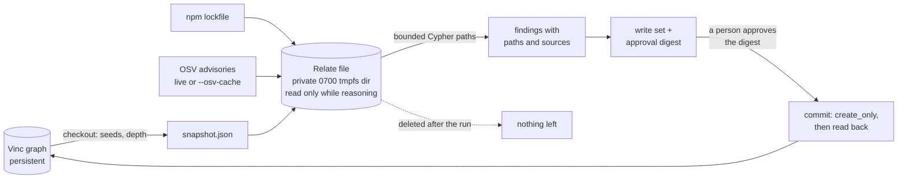

# decisis

[](https://github.com/Vinculums/decisis/actions/workflows/test.yml)
[](https://pypi.org/project/decisis/)

**Stand by what was decided.** decisis (from *stare decisis*) checks work against the decisions a team
has already made. It takes the slice of decisions a task needs, joins it with outside facts (an npm
lockfile and OSV advisories) in a throwaway [Relate](https://github.com/relatedb/relate) graph, finds
multi-hop paths from a decision to the thing that breaks it, and deletes the graph when the task ends.

It runs offline with no account: decisions come from a plain JSON snapshot (`docs/data-model.md`).
Connecting a [Vinc](https://vincs.io) space is optional and yours to configure (`VINC_API_KEY`, see
[What needs an account](#what-needs-an-account)): then `checkout` reads the snapshot from Vinc, and
`commit` writes findings back only after a person approves the exact write set by its digest, reading
every write back before the run counts as done.

The project was called vinc-relate until 2026-11-24. The `vinc-relate` command and `import vinc_relate`
still work for one more release.



Entry for the Relate by Neo4j hackathon, "Context, Connected". Licensed under Apache-2.0 (`LICENSE`).

## Five-minute setup

To try it, install it from [PyPI](https://pypi.org/project/decisis/) and run the demo, which needs
no account and no network after the install:

```
pip install decisis
decisis demo
```

The [npm package](https://www.npmjs.com/package/decisis) only points here; decisis is a Python tool.

To work on it, set it up from the repository:

You need Python 3.11 or newer, git and [uv](https://docs.astral.sh/uv/). No Vinc account and no API key.
The install fetches `relate-db` from PyPI once; every command after it runs offline.

```
git clone https://github.com/Vinculums/decisis.git
cd decisis
uv venv .venv && uv pip install --python .venv/bin/python -e ".[dev]"
.venv/bin/python -m pytest -q
.venv/bin/decisis demo
```

Without uv: `python3 -m venv .venv && .venv/bin/pip install -e ".[dev]"`. On Windows the scripts are
under `.venv\Scripts\` instead of `.venv/bin/`.

`decisis demo` runs the whole procedure on synthetic data in under a second: a synthetic Vinc
space served by an in-process fake Vinc, a checkout of only the app's knowledge (3 of 9 nodes), a
Relate graph that joins it with the demo lockfile and cached OSV advisories (14 nodes, 15 edges), a
five-hop path from a decision to an advisory, a Checker that re-derives each proposed record from the
sandbox (31 checks over 7 records), and the write set with its approval digest. It stops there and
writes nothing. The path it finds:

```
decision:no-high-advisories-in-shipped-dependencies -ABOUT-> concept:demo-app <-DESCRIBED_BY- repo:Demo
  -DEPENDS_ON-> pkg:npm/report-kit@2.1.0 -DEPENDS_ON-> pkg:npm/lodash@4.17.15 -AFFECTED_BY-> adv:GHSA-r5fr-rjxr-66jc
```

The rule lives in the knowledge graph, the dependency chain in the lockfile and the advisory in OSV;
no single source holds the connection. Then approve, as the person would:

```
.venv/bin/decisis demo --approve d761d1c8a44d62e2
git diff demo/transcript.json
```

The records go to the fake Vinc with `create_only`, every node and edge is read back, and a new
checkout finds the committed edges with their type and direction. The digest is the same on every
run because the records are dated by the OSV cache. Both runs write `demo/transcript.json`,
`demo/expected_findings.json` and `demo/sample.rl` (a copy of the sandbox graph for inspection, synthetic
data only). The committed copies come from the approved run, so `git diff demo/transcript.json` shows
only its `timestamps` block changed; `sample.rl` is rebuilt, so its bytes differ. The sandbox itself is
deleted.

## Does the graph help? The measured comparison

```
.venv/bin/decisis compare
```

`compare` runs nine tasks from `bench/tasks.json` three ways, offline and without a model:
**A** answers from the Vinc snapshot alone (nodes whose `code_ref` matches the subject, then one hop);
**B** adds the lockfile and the advisories as flat records joined by package name, with the same version
range check and policy rule as C; **C** loads all three into a Relate graph and queries it. The tasks and
their expected findings were committed before the first run. A path or a policy link counts when it
equals an expected one; any other claim is unsupported; a claim is covered when its evidence is a
connected chain of edges that exist in the inputs.

| Method | Path discovery | Policy links | Findings | Unsupported claims | Evidence coverage | Latency (ms, all tasks) |
|---|---|---|---|---|---|---|
| A | 5/13 | 5/17 | 0/5 | 0/10 | 10/10 | 0.2 |
| B | 9/13 | 15/17 | 5/5 | 1/30 | 27/30 | 0.6 |
| C | 13/13 | 17/17 | 5/5 | 0/35 | 35/35 | 85.0 |

Against B, C is better on 2 tasks, the same on 7 and worse on none. It helped where a connection spans
sources: a vulnerable package reached only through a shared transitive dependency, and a decision two
hops from the code it governs. Per-task numbers are in `bench/results.md`, every claim with its
coverage in `bench/results.json`. Latency is the only number that changes between runs; C's includes
building and loading a graph for each task.

Read the numbers with these caveats:

- **B's policy-link score is generous.** On the shared transitive dependency B claims a wrong chain
  (through test-kit, which has its own nested copy), yet both of its policy links on that task still
  count as correct because they name the right decision and advisory. Their evidence chain is the wrong
  one; the coverage column (27/30) is where that shows.
- **"C against B" compares paths, policy links and unsupported claims only.** Findings, coverage and
  latency are not part of that label.
- **The impact rule was fitted after seeing the decoy.** `impact` follows a `RELATED_TO` edge only from a
  concept that names no code of its own. That condition was chosen after the overreach decoy task had
  been run, because edge type and direction alone cannot tell the expected path from the decoy. The
  expected findings were not changed, but the rule is fitted on this benchmark; a held-out set is
  needed to show it generalises.
- **The benchmark is small and synthetic.** Nine hand-built tasks show which kinds of connection need a
  graph, not how often they occur in real repositories.

## What needs an account

| Command | Needs | What it does |
|---|---|---|
| `demo` | nothing | the whole procedure on synthetic data, against an in-process fake Vinc |
| `compare` | nothing | the A/B/C benchmark above |
| `paths <snapshot> <from> <to>` | nothing | bounded paths between two ids in any snapshot file |
| `impact <snapshot> <code path>...` | nothing | the decisions and records that govern a code path |
| `audit <snapshot> <lockfile> --repo <name>` | nothing; the network for api.osv.dev unless `--osv-cache` | advisories the repository reaches and the decisions they break |
| `propose <report> --repo <name> --space <space>` | nothing; it only writes a file | the exact write set and its approval digest |
| `checkout <seed>... --out <file>` | a read-only Vinc key | exports a bounded subgraph from Vinc |
| `commit <plan> --approve <digest>` | a full Vinc key | writes an approved write set and reads it back |

A snapshot is a plain JSON file. `docs/data-model.md` gives the format with a small hand-written
example, so you can run `paths`, `impact` and `audit` on your own knowledge without Vinc.

Try them on the synthetic fixtures:

```
.venv/bin/decisis paths fixtures/vinc_subgraph.json record:tls-advisory-example concept:service-api
.venv/bin/decisis impact fixtures/impact/vinc.json reports/export.py storage/ --format text
.venv/bin/decisis audit fixtures/audit/vinc.json fixtures/audit/demo-lockfile.json --repo Demo --osv-cache fixtures/audit/osv-cache.json --out report.json
.venv/bin/decisis propose report.json --repo Demo --space demo-space --out plan.json
```

`report.json`, `plan.json` and `snapshot.json` at the repository root are ignored by git. Without
`--osv-cache`, `audit` asks api.osv.dev; if the network fails it prints one line that says so and
points at `--osv-cache`.

With a Vinc account (needs a key):

```
VINC_API_KEY=<read-only key> VINC_SPACE=<space id> .venv/bin/decisis checkout <seed id> ... --out snapshot.json
VINC_API_KEY=<full key> .venv/bin/decisis commit plan.json --approve <digest>
```

Without `VINC_SPACE`, `checkout` reads the key's default space, and the snapshot's `meta.space` says
`personal`. Write to a real space only after its owner approves the printed write set.

## How an agent uses it

`skills/decisis/SKILL.md` is a skill for a coding agent such as Claude Code: when to reach for
`audit`, `impact` or `paths`, how to check out only what the task names, how to read a finding, and the
rule that the agent shows the write set and digest to the person and stops. The agent never approves
its own write. To use it, put the directory where your agent loads skills (for Claude Code,
`.claude/skills/decisis/`) with `decisis` on the agent's `PATH`.

decisis itself calls no language model. The agent is the reasoner that chooses seeds, runs the
bounded queries and explains the paths; the tool gives it a graph it cannot write to, findings that
carry their evidence, and a write path that needs a person's digest.

## What is proven, and what is future work

Proven by the tests in `tests/` (run offline in CI on Python 3.11 and 3.12) and by the runs above:

- A Vinc subgraph is exported over the Vinc MCP with stable ids, edge direction and evidence, and a
  snapshot whose counts disagree with its lists is refused.
- The snapshot loads into a Relate file; the loader compares what landed with the snapshot and names a
  repeated id or an edge with a missing endpoint. A bounded multi-hop query returns the expected path.
- Reasoning opens the file read only and a write is refused; an open writer locks out a second writer
  and any reader.
- The task directory is private (0700), under `/dev/shm` when it is writable, and removed after the run.
- The audit joins the snapshot, the lockfile (nested copies resolved) and OSV, checks the installed
  version against the advisory ranges, and keeps each advisory's source URL, fetch time and content hash.
- `commit` refuses a digest that does not match the plan as it stands, writes with `create_only`, and
  fails when a node, a property or an edge's type or direction does not come back.
- A live run against a real Vinc space wrote and read back seven records with `create_only`, and a second
  run with the same approval wrote nothing. That space is not public; `decisis demo --approve` is the
  reproducible version.

Future work, not built:

- A Relate MCP server as the agent's read-only query surface; today the agent drives the CLI.
- Ecosystems other than npm, and repository metadata beyond the lockfile.
- The demo's Checker (re-deriving each record) also in the `propose` path for real data.
- Query time limits, a cap on imported graph size and on `audit --depth`; today `paths` and `impact` bound hops and results.
- Encrypted scratch storage with key destruction for sensitive data (see `docs/threat-model.md`).
- A held-out benchmark set, and real repositories, to test whether the comparison holds.

## More

- `docs/architecture.md`: modules, the sandbox lifecycle, the queries, and the write path.
- `docs/data-model.md`: the snapshot format with a hand-written example, the Relate graph, the report and the plan.
- `docs/threat-model.md`: what the sandbox protects and what it does not.
