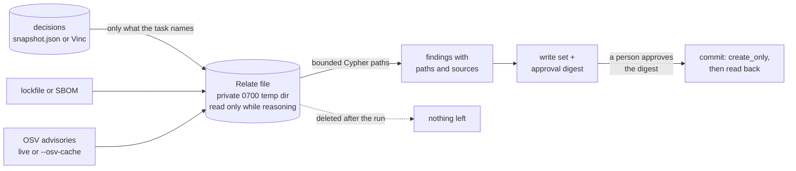

<p align="center">
  
</p>

# decisis

**Check work against the decisions your team already made, in a throwaway graph, offline.**

[](https://github.com/Vinculums/decisis/actions/workflows/test.yml)
[](https://pypi.org/project/decisis/)
[](https://pypi.org/project/decisis/)
[](https://github.com/Vinculums/decisis/blob/main/LICENSE)
[](https://github.com/relatedb/relate)


**[Watch the decisis explainer video (1:56)](https://drive.google.com/file/d/14JvwIcmERP63fM_bOJMgUvgFd0jyUDn8/view?usp=sharing)**

decisis (from *stare decisis*, "stand by what was decided") checks a change against the decisions your
team already made. It joins those decisions with your code paths, a lockfile and OSV advisories in a
throwaway [Relate](https://github.com/relatedb/relate) graph, and shows the path from a decision to the
thing that breaks it. Every finding carries that path and its sources.

- **No account, no model, offline.** Decisions come from a JSON snapshot that `init` builds from your ADRs,
  CODEOWNERS, postmortems and pull requests.
- **Nothing is written back** unless a person approves the exact write set by its digest.
- **Not a linter or a full scanner.** `check` reads imports only, and `audit` reads the
  [15 inventory formats](https://github.com/Vinculums/decisis/blob/main/docs/data-model.md#inventories) listed below.

## Install

```bash
pip install decisis          # or: uv tool install decisis / pipx install decisis
decisis demo                 # synthetic data, under a second, writes nothing
```

Python 3.11 or newer on macOS, Linux or Windows. After the install, every command runs offline, except that
`audit` and `propose` ask api.osv.dev when you give it no `--osv-cache`, and `init --github` reads api.github.com.

The demo finds a five-hop path that no single source holds: the rule is in the decisions, the chain is in
the lockfile and the advisory is in OSV.

```
decision:no-high-advisories-in-shipped-dependencies -ABOUT-> concept:demo-app <-DESCRIBED_BY- repo:Demo
  -DEPENDS_ON-> pkg:npm/report-kit@2.1.0 -DEPENDS_ON-> pkg:npm/lodash@4.17.15 -AFFECTED_BY-> adv:GHSA-r5fr-rjxr-66jc
```

## Quick start

**1. Build a snapshot of your decisions** from the repository's ADRs (MADR or Nygard), CODEOWNERS and
postmortems. `--github OWNER/REPO` also reads merged pull requests labelled `decision`.

```bash
decisis init --repo-dir . --repo Shop --out snapshot.json
```

You can also write a snapshot by hand: one JSON file of nodes and edges
([every field](https://github.com/Vinculums/decisis/blob/main/docs/data-model.md)).

```json
{
 "nodes": [
  {"id": "concept:shop-web", "kind": "concept", "title": "Shop web app", "props": {"code_ref": "Shop:src/"}},
  {"id": "concept:checkout-flow", "kind": "concept", "title": "Checkout flow", "props": {"code_ref": "Shop:src/checkout/"}},
  {"id": "decision:no-high-advisories-when-shipped", "kind": "decision", "title": "No high advisories in what we ship",
   "props": {"rule": {"advisory_severity_at_least": "HIGH", "dependencies": "shipped"}}},
  {"id": "record:checkout-timeout-october", "kind": "record", "title": "Checkout timed out under load"}
 ],
 "edges": [
  {"source": "decision:no-high-advisories-when-shipped", "target": "concept:shop-web", "type": "ABOUT", "evidence": "applies to the whole app"},
  {"source": "concept:checkout-flow", "target": "concept:shop-web", "type": "RELATED_TO", "evidence": "part of the app"},
  {"source": "record:checkout-timeout-october", "target": "concept:checkout-flow", "type": "RELATED_TO", "evidence": "the timeout was in this flow"}
 ]
}
```

**2. Ask what governs a file before you change it.** With the snapshot above saved as `my-snapshot.json`:

```
$ decisis impact my-snapshot.json src/checkout/pay.py --format text
src/checkout/pay.py: 4 node(s) within 3 hop(s)
  [0] concept  concept:checkout-flow  code_ref Shop:src/checkout/ (encloses)
  [0] concept  concept:shop-web  code_ref Shop:src/ (encloses)
  [1] decision decision:no-high-advisories-when-shipped  via concept:shop-web
        decision:no-high-advisories-when-shipped -ABOUT-> concept:shop-web  (applies to the whole app)
  [1] record   record:checkout-timeout-october  via concept:checkout-flow
        record:checkout-timeout-october -RELATED_TO-> concept:checkout-flow  (the timeout was in this flow)
```

**3. Check a change against the decisions' rules.** A decision's `rule` can name the reviewers a path
needs and the imports a part of the code must not make. `check` exits 1 on a violation:

```
$ decisis check fixtures/check/vinc.json --repo-dir fixtures/check/repo --changed src/shop/ui/view.py src/payments/charge.py --reviewers @bob --format text
2 changed file(s); reviewers: @bob
governing decisions: 2
  decision:payments-need-a-payments-review  Payment changes need a review from the payments team  (src/payments/charge.py)
  decision:ui-does-not-import-db  The user interface reads data through the API, never the database layer  (src/shop/ui/view.py)
superseded, not judged:
  decision:payments-reviewed-by-carol  superseded by decision:payments-need-a-payments-review
rules that cover a changed file: 2
violations: 3
  src/payments/charge.py  decision:payments-need-a-payments-review  review_required: src/payments/** needs a review from @alice or @shop/payments; none of them is among the reviewers given
  src/shop/ui/view.py:4  decision:ui-does-not-import-db  imports_forbidden: src/shop/ui/** must not import src/shop/db/**; from shop.db import models is src/shop/db/models.py
  src/shop/ui/view.py:5  decision:ui-does-not-import-db  imports_forbidden: src/shop/ui/** must not import src/shop/db/**; from ..db.session import open_session is src/shop/db/session.py
cannot be judged: 1
  src/shop/ui/view.py:10  decision:ui-does-not-import-db  imports_forbidden: import_module() with a computed name: the specifier is computed at run time; it cannot be judged
```

In CI, pass the base branch instead of a file list: `decisis check snapshot.json --base origin/main --reviewers @alice`.

CODEOWNERS gives ownership context only: `check` lists the owners of the changed files that no `review_required` rule
covers, and a missing owner review changes no verdict. To enforce it, turn on "Require review from Code Owners" in
GitHub's branch protection, or write the rule in an ADR so `check` judges it:

```yaml
rule:
  review_required:
    paths: ["src/payments/**"]
    reviewers: ["@shop/payments"]
```

**4. Audit a lockfile against the decisions.** In the snapshot `init` built in step 1, each ADR with a
dependency rule (advisory, license, package or pin) governs the repository `init` read, whatever code it
names, so give `audit` the same `--repo`:

```bash
decisis audit snapshot.json package-lock.json --repo Shop --out report.json
```

The example repository in this checkout has ADR 0010, which forbids HIGH advisories in shipped
dependencies; its snapshot and the demo lockfile give three violations of it:

```bash
decisis init --repo-dir fixtures/init/shop --repo Shop --out shop.json
```

```
$ decisis audit shop.json fixtures/audit/demo-lockfile.json --repo Shop --osv-cache fixtures/audit/osv-cache.json --out report.json
{"summary": {"affected": 7, "unresolved": 0, "not_affected": 0}, "violations": 3, "waived": 0, "loaded": {"nodes": 23, "edges": 17}, "unresolved_packages": 0, "inventory_notes": [], "unread_decisions": 1, "out": "report.json"}
```

The report lists each advisory the repository reaches, the dependency path to it, and the decisions it
breaks. A hand-written snapshot, like the one above, links a decision to the repository through `ABOUT` a
node whose `code_ref` names it. A decision with a dependency rule that governs nothing in the audit is
listed under `not_governing` with the reason, so its rule never drops out unseen
([which decisions an audit judges](https://github.com/Vinculums/decisis/blob/main/docs/data-model.md#which-decisions-an-audit-judges)).

## Supported inventories and rules

- **Inventories:** npm, pnpm, Yarn (v1 and Berry), Bun, uv, Poetry, pip requirements, Cargo, Go modules,
  Gradle, Maven, CycloneDX, SPDX, GitHub Actions workflows and Terraform lock files.
  [What each one reads](https://github.com/Vinculums/decisis/blob/main/docs/data-model.md#inventories).
- **Rules:** `advisory_severity_at_least`, `license_denied`, `license_allowed`, `package_denied`,
  `package_allowed` and `pinned_to_commit` are judged by `audit`; `review_required` and `imports_forbidden`
  are judged by `check`. [Rule format](https://github.com/Vinculums/decisis/blob/main/docs/data-model.md#rules).

```json
[{"advisory_severity_at_least": "HIGH", "dependencies": "shipped"},
 {"license_denied": ["GPL-3.0-only", "AGPL-3.0-only"], "dependencies": "shipped"},
 {"pinned_to_commit": true}]
```

A package or import that a rule cannot judge is `unresolved`, never clean.

A decision's `waivers` accept a known violation until a date: each names a package (and optionally one
advisory) or a path glob (and optionally an import target), with a `reason`, an `expires` date and
`approved_by`. A covered violation is `waived` through that date, is not counted as a violation, and is
`violated` again from the next day. [Waiver format](https://github.com/Vinculums/decisis/blob/main/docs/data-model.md#waivers).

## GitHub Action

On a pull request, the action runs `check` (and `audit` when you give it an inventory) and keeps one
comment up to date with the violations and a Mermaid path graph.

```yaml
name: decisis
on:
  pull_request:
permissions: {}
concurrency:
  group: decisis-${{ github.event.pull_request.number }}
  cancel-in-progress: true
jobs:
  decisis:
    runs-on: ubuntu-latest
    permissions:
      contents: read
      pull-requests: write
    steps:
      - uses: actions/checkout@3d3c42e5aac5ba805825da76410c181273ba90b1 # v7.0.1
        with:
          fetch-depth: 0
          persist-credentials: false
      - uses: Vinculums/decisis@v0         # or pin a release commit SHA
        with:
          snapshot: decisions.json        # or init: true
          inventory: package-lock.json    # optional: also run audit
          fail-on-violation: false
```

It is on the Marketplace as [decisis check](https://github.com/marketplace/actions/decisis-check). The decisions come from the pull request's base commit, so editing a decision file does not change the pull request's own verdict; guard the workflow and the decision files with CODEOWNERS and make the check required. The comment's footer holds one factual line, for example `Checked with decisis 0.5.0 (0 LLM calls · deterministic graph check · pull request reviews from api.github.com · digest: …)`, that says what the run fetched and gives a digest of the result; `signature: false` leaves it out, as `--no-signature` does for `check` and `audit` with `--format html`. [Inputs, permissions, fork handling and the trust model](https://github.com/Vinculums/decisis/blob/main/docs/action.md).

## AI agents: skill and MCP

```
pip install "decisis[mcp]"
claude mcp add decisis -- decisis serve --mcp --snapshot snapshot.json --osv-cache osv-cache.json
```

The server gives an agent `impact`, `paths`, `audit`, `check`, `search` and a read-only Cypher `query` as MCP tools. It has no
tool that writes. [`skills/decisis/SKILL.md`](https://github.com/Vinculums/decisis/blob/main/skills/decisis/SKILL.md)
teaches an agent when to use each tool. [MCP setup and the `query` rules](https://github.com/Vinculums/decisis/blob/main/docs/mcp.md).

The same server runs from Cursor, Windsurf, VS Code with GitHub Copilot and the OpenAI Codex CLI as well as Claude
Code: [the config file and snippet for each tool](https://github.com/Vinculums/decisis/blob/main/docs/mcp.md#set-up-your-tool).
[A worked example](https://github.com/Vinculums/decisis/blob/main/examples/bookshop/README.md) runs `init`, `check`,
`audit` and the MCP tools on a small application, with every output committed.

## Commands

| Command | Needs | What it does |
|---|---|---|
| `demo` | nothing | the whole procedure on synthetic data, against an in-process fake Vinc |
| `init --out <file>` | nothing; with `--github`, the network for api.github.com | a snapshot from the repository's ADRs, CODEOWNERS and postmortems, and its merged pull requests; with `--suggest-refs`, code refs from the paths each ADR names, and with `--patch FILE` a diff that states them in the ADRs |
| `new-adr "<title>" [--code-ref <path>]... [--rule <json>]` | nothing | writes the next-numbered MADR file with `status: proposed`, after checking the rule as `audit` and `check` read it; never overwrites |
| `impact <snapshot> <code path>...` | nothing | the decisions and records that govern a file or directory |
| `check <snapshot> (--changed <file>... \| --base <ref>)` | nothing; with `--base`, git | the decisions that govern a change set, and the `review_required` and `imports_forbidden` rules it breaks; exits 1 on a violation |
| `paths <snapshot> <from> <to>` | nothing | bounded paths between two ids; with `--keep-graph FILE` saves a copy of the `.rl` graph |
| `query <snapshot or .rl or vault> <cypher> [--param KEY=VALUE] [--profile]` | nothing | one read-only Cypher statement on a snapshot, saved `.rl` file or Markdown vault, rows as JSON; `--profile` adds Relate's execution plan and operator timings |
| `search <snapshot> <query>` | nothing | offline keyword search over decisions, records and concepts using Relate's built-in fulltext index (no model) |
| `export-vault <snapshot> --out <dir> [--lockfile FILE --repo NAME]` | nothing (or api.osv.dev with `--lockfile` and no `--osv-cache`) | exports a snapshot or composed audit graph as a Relate Markdown vault (Obsidian-ready `.md` notes with `[[wikilinks]]`, git-diffable and queryable with Cypher) |
| `audit <snapshot> <lockfile or SBOM> --repo <name>` | the network for api.osv.dev (and OSV's GitHub Actions export for workflows), unless `--osv-cache` | advisories the repository reaches and the decisions they break; `--keep-graph FILE` saves `.rl` and `--export-vault DIR` writes a Markdown vault |
| `propose <report> <snapshot> <lockfile or SBOM> --repo <name> --space <space>` | the network for api.osv.dev, unless `--osv-cache` | re-derives each record, holds back any that fail, and prints the exact write set and its approval digest |
| `compare [--tasks FILE]` | nothing; the held-out tasks need a checkout of this repository | the [benchmarks](https://github.com/Vinculums/decisis/blob/main/docs/benchmark.md) |
| `checkout <seed>... --out <file>` | a read-only Vinc key | exports a bounded subgraph from Vinc |
| `commit <plan> --approve <digest>` | a full Vinc key | writes an approved write set and reads it back |
| `gc` | nothing | removes task directories that a killed run left behind, and prints them |
| `serve --mcp --snapshot <file>` | the `mcp` extra; the network for api.osv.dev only with `--allow-network` | `impact`, `paths`, `audit`, `check`, `search` and `query` as read-only MCP tools over stdio ([MCP](https://github.com/Vinculums/decisis/blob/main/docs/mcp.md)) |

To inspect a saved `.rl` graph or exported Markdown vault visually in Neo4j Browser, run Relate's built-in server read-only:

```bash
decisis audit snapshot.json package-lock.json --repo Shop --keep-graph audit.rl --export-vault audit-vault/
decisis query audit.rl "MATCH (d:Decision) RETURN d.id, d.title" --profile
relate serve --database audit.rl --bolt 7687 --read-only
```

[Flags, limits and the Mermaid and HTML views](https://github.com/Vinculums/decisis/blob/main/docs/commands.md).

## How it works



The graph is loaded into a private temporary directory, queried read-only with bounded Cypher, and deleted
when the task ends. `propose` re-checks each finding in a fresh graph before it prints the write set, and
`commit` writes only the set whose digest a person approved, then reads every node and edge back.
[Architecture](https://github.com/Vinculums/decisis/blob/main/docs/architecture.md) and [threat model](https://github.com/Vinculums/decisis/blob/main/docs/threat-model.md).

## Does the graph help?

`decisis compare` runs each task three ways: A uses the decisions alone, B adds the lockfile and advisories
as flat records, and C queries them in a Relate graph. Against B, C is better on 2 of 9 synthetic tasks and on
8 of 30 tasks from five open-source repositories, and worse on none. The gain is where a connection
spans sources, such as a vulnerable package three to seven hops from the repository.
[The numbers and their caveats](https://github.com/Vinculums/decisis/blob/main/docs/benchmark.md).

[What is tested, and what is not built yet](https://github.com/Vinculums/decisis/blob/main/docs/status.md).

## Connect Vinc (optional)

`checkout` exports a snapshot from a [Vinc](https://vincs.io) space, and `commit` writes an approved write
set back:

```
VINC_API_KEY=<read-only key> VINC_SPACE=<space id> decisis checkout <seed id> ... --out snapshot.json
VINC_API_KEY=<full key> decisis commit plan.json --approve <digest>
```

## Development

```
git clone https://github.com/Vinculums/decisis.git && cd decisis
uv venv .venv && uv pip install --python .venv/bin/python -e ".[dev,mcp]"
.venv/bin/python -m pytest -q
.venv/bin/python scripts/gate_comments.py
.venv/bin/decisis demo --approve d761d1c8a44d62e2
```

The last line approves the demo's write set as a person would. The held-out benchmark is slow and runs only
when asked: `DECISIS_SLOW=1 .venv/bin/python -m pytest -q -m slow`. `fixtures/` and `bench/` hold lockfiles
with known advisories on purpose, so Dependabot alerts on those paths are dismissed as test fixtures.

Code carries no comments and no docstrings, only machine pragmas such as `# noqa` or `# type: ignore`.
`scripts/gate_comments.py` counts them per file against `scripts/comments-baseline.json`, a baseline that only goes
down; the `test` workflow runs it. Put the reason for a change in the commit message.

## Name and history

The project was called vinc-relate until 2026-11-24. The `vinc-relate` command and the `vinc_relate`
import name were removed in 0.2.0. decisis is an entry for the Relate by Neo4j hackathon, "Context, Connected".

## License

Apache-2.0. See [`LICENSE`](https://github.com/Vinculums/decisis/blob/main/LICENSE).
