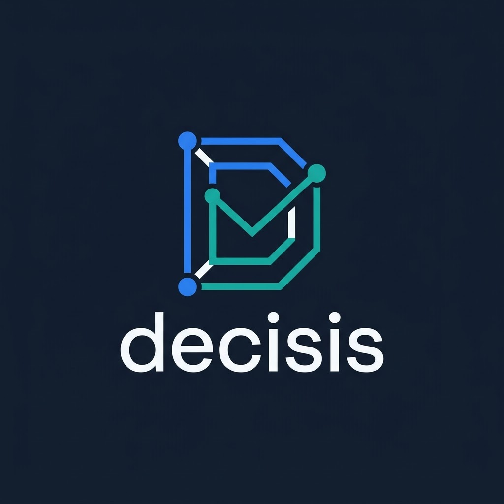
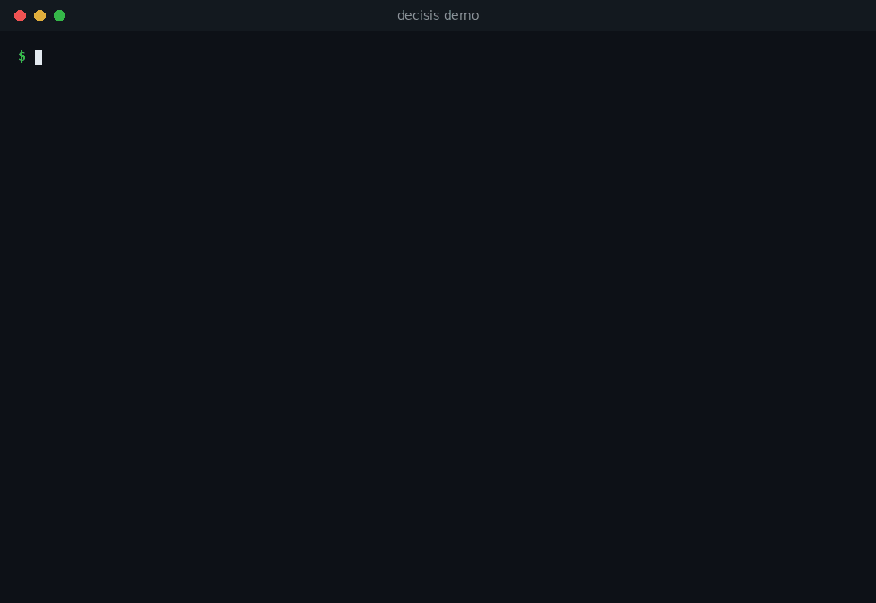

<p align="center">
  
</p>

# decisis

**Check work against the decisions your team already made, in a throwaway graph, offline.**

[](https://github.com/Vinculums/decisis/actions/workflows/test.yml)
[](https://pypi.org/project/decisis/)
[](https://pypi.org/project/decisis/)
[](https://github.com/Vinculums/decisis/blob/main/LICENSE)
[](https://github.com/relatedb/relate)



decisis (from *stare decisis*, "stand by what was decided") is a command-line tool and Python package.
It takes the decisions a task needs, joins them with code paths and outside facts (an npm lockfile and
OSV advisories) in a throwaway [Relate](https://github.com/relatedb/relate) graph, and finds the
multi-hop path from a decision to the thing that breaks it. Every finding carries that path and its
sources. The graph lives in a private temporary directory and is deleted when the task ends.

It needs no account and no model. Decisions come from a plain JSON snapshot that you can write by hand,
or from a [Vinc](https://vincs.io) space if you connect one. Nothing is written back anywhere unless a
person approves the exact write set by its digest.

What it is not, today: a linter that reads your code, a vulnerability scanner for every ecosystem, or a
place to store decisions. It reads npm lockfiles only, decisions come from a snapshot file or Vinc, and
the benchmark below is small and synthetic. [What is proven, and what is not built yet](#what-is-proven-and-what-is-not-built-yet)
has the full list.

## Install

Python 3.11 or newer on macOS, Linux or Windows (x86-64; arm64 on macOS and Linux).

```bash
pip install decisis
```

As an isolated command-line tool:

```bash
uv tool install decisis      # or: pipx install decisis
```

The install fetches `relate-db` from PyPI once; every command after it runs offline, except `audit`
asking api.osv.dev when you give it no `--osv-cache`. The [npm package](https://www.npmjs.com/package/decisis)
only points here.

## Quick start

**1. Watch the whole procedure on synthetic data** (under a second, writes nothing):

```bash
decisis demo
```

It checks out 3 of 9 nodes from a synthetic team graph, joins them with a lockfile and cached OSV
advisories in a Relate graph (14 nodes, 15 edges), finds the five-hop path below, has a Checker
re-derive each proposed record (31 checks over 7 records), and stops at the write set and its digest:

```
decision:no-high-advisories-in-shipped-dependencies -ABOUT-> concept:demo-app <-DESCRIBED_BY- repo:Demo
  -DEPENDS_ON-> pkg:npm/report-kit@2.1.0 -DEPENDS_ON-> pkg:npm/lodash@4.17.15 -AFFECTED_BY-> adv:GHSA-r5fr-rjxr-66jc
```

The rule lives in the team's decisions, the dependency chain in the lockfile and the advisory in OSV;
no single source holds the connection.

**2. Use your own decisions.** Write a snapshot: one JSON file of nodes and edges. This one has an app,
a checkout flow, one decision and one incident record ([`docs/data-model.md`](https://github.com/Vinculums/decisis/blob/main/docs/data-model.md) has
every field):

```json
{
 "nodes": [
  {"id": "concept:shop-web", "kind": "concept", "title": "Shop web app", "props": {"code_ref": "Shop:src/"}},
  {"id": "concept:checkout-flow", "kind": "concept", "title": "Checkout flow", "props": {"code_ref": "Shop:src/checkout/"}},
  {"id": "decision:no-high-advisories-when-shipped", "kind": "decision", "title": "No high advisories in what we ship",
   "props": {"rule": {"advisory_severity_at_least": "HIGH", "dependencies": "shipped"}}},
  {"id": "record:checkout-timeout-october", "kind": "record", "title": "Checkout timed out under load"}
 ],
 "edges": [
  {"source": "decision:no-high-advisories-when-shipped", "target": "concept:shop-web", "type": "ABOUT", "evidence": "applies to the whole app"},
  {"source": "concept:checkout-flow", "target": "concept:shop-web", "type": "RELATED_TO", "evidence": "part of the app"},
  {"source": "record:checkout-timeout-october", "target": "concept:checkout-flow", "type": "RELATED_TO", "evidence": "the timeout was in this flow"}
 ]
}
```

**3. Ask what governs a file before you change it:**

```
$ decisis impact my-snapshot.json src/checkout/pay.py --format text
src/checkout/pay.py: 4 node(s) within 3 hop(s)
  [0] concept  concept:checkout-flow  code_ref Shop:src/checkout/ (encloses)
  [0] concept  concept:shop-web  code_ref Shop:src/ (encloses)
  [1] decision decision:no-high-advisories-when-shipped  via concept:shop-web
        decision:no-high-advisories-when-shipped -ABOUT-> concept:shop-web  (applies to the whole app)
  [1] record   record:checkout-timeout-october  via concept:checkout-flow
        record:checkout-timeout-october -RELATED_TO-> concept:checkout-flow  (the timeout was in this flow)
```

**4. Audit a lockfile against those decisions:**

```bash
decisis audit my-snapshot.json package-lock.json --repo Shop --out report.json
```

`report.json` lists each advisory the repository reaches, the dependency path to it, and the decisions
it breaks. With the demo lockfile and its cached advisories, three findings on shipped `lodash` break the
decision above.

## How it works


1. **Check out** only the slice of decisions a task names: a snapshot file, or `checkout` from Vinc.
2. **Load** it with the outside facts into a fresh Relate file in a private directory (under `/dev/shm`
   when it is writable). The loader checks that every node and edge landed.
3. **Reason** read only with bounded Cypher queries (`src/decisis/queries/*.cypher`), so every answer is
   a path you can follow edge by edge.
4. **Propose and approve.** `propose` turns findings into an exact write set with a digest. Nothing is
   written until a person passes that digest to `commit`, which writes with `create_only` and reads every
   node and edge back.
5. **Delete** the graph when the task ends.

## Commands

| Command | Needs | What it does |
|---|---|---|
| `demo` | nothing | the whole procedure on synthetic data, against an in-process fake Vinc |
| `impact <snapshot> <code path>...` | nothing | the decisions and records that govern a file or directory |
| `paths <snapshot> <from> <to>` | nothing | bounded paths between two ids |
| `audit <snapshot> <lockfile> --repo <name>` | the network for api.osv.dev, unless `--osv-cache` | advisories the repository reaches and the decisions they break |
| `propose <report> --repo <name> --space <space>` | nothing; it only writes a file | the exact write set and its approval digest |
| `compare` | nothing | the benchmark below |
| `checkout <seed>... --out <file>` | a read-only Vinc key | exports a bounded subgraph from Vinc |
| `commit <plan> --approve <digest>` | a full Vinc key | writes an approved write set and reads it back |

Useful flags: `impact --hops N --format text`, `paths --hops N --limit N`, `audit --osv-cache FILE --depth N`.
`impact`, `paths` and `audit` print JSON (`impact --format text` reads better for people); `demo`, `propose`
and `compare` print text. `decisis <command> --help` lists the rest.

Try them on the fixtures in this repository:

```
decisis paths fixtures/vinc_subgraph.json record:tls-advisory-example concept:service-api
decisis impact fixtures/impact/vinc.json reports/export.py storage/ --format text
decisis audit fixtures/audit/vinc.json fixtures/audit/demo-lockfile.json --repo Demo --osv-cache fixtures/audit/osv-cache.json --out report.json
decisis propose report.json --repo Demo --space demo-space --out plan.json
```

## Use it from an AI agent

[`skills/decisis/SKILL.md`](https://github.com/Vinculums/decisis/blob/main/skills/decisis/SKILL.md) is a skill for a coding agent such as Claude Code. It
covers when to reach for `audit`, `impact` or `paths`, how to check out only what the task names, how to
read a finding, and the rule that the agent shows the write set and digest to the person and stops. The
agent never approves its own write. To use it, copy the directory to where your agent loads skills (for
Claude Code, `.claude/skills/decisis/`) and put `decisis` on the agent's `PATH`.

decisis itself calls no language model. The agent is the reasoner that chooses seeds, runs the bounded
queries and explains the paths; the tool gives it a graph it cannot write to, findings that carry their
evidence, and a write path that needs a person's digest.

### Serve it over MCP

`decisis serve --mcp` gives an agent the same `impact`, `paths` and `audit` as MCP tools over stdio, on
one snapshot fixed when the server starts. It needs the optional `mcp` extra; the base install keeps
`relate-db` as its only dependency. For Claude Code:

```
pip install "decisis[mcp]"
claude mcp add decisis -- decisis serve --mcp --snapshot snapshot.json --osv-cache osv-cache.json
```

`claude mcp add --scope project ...` writes the same entry to `.mcp.json` in the project, to share it
with the team:

```json
{
  "mcpServers": {
    "decisis": {
      "command": "decisis",
      "args": ["serve", "--mcp", "--snapshot", "snapshot.json", "--osv-cache", "osv-cache.json"]
    }
  }
}
```

Relative paths are read from the directory the server starts in; use absolute paths if you are not sure
which one that is. The server has no tool that writes, proposes or commits. The tools take the same
bounds as the commands (`hops` 0 to 6 for `impact`, 1 to 6 for `paths`, `limit` 1 to 100; `audit` takes
`depth` 1 to 16), refuse a code path outside the repository, and build and delete a sandbox for each call.
`audit` takes the lockfile path as an argument and reads it only under `--root` (default: the current
directory), after following symlinks. It reads advisories from `--osv-cache`; without a cache it asks
api.osv.dev only when the server was started with `--allow-network`, and otherwise returns an error.

## Connect Vinc (optional)

```
VINC_API_KEY=<read-only key> VINC_SPACE=<space id> decisis checkout <seed id> ... --out snapshot.json
VINC_API_KEY=<full key> decisis commit plan.json --approve <digest>
```

`VINC_MCP_URL` points at another Vinc server. Without `VINC_SPACE`, `checkout` reads the key's default
space, and the snapshot's `meta.space` says `personal`. Write to a real space only after its owner
approves the printed write set.

## Does the graph help? The measured comparison

```
decisis compare
```

`compare` runs nine tasks from `bench/tasks.json` three ways, offline and without a model:
**A** answers from the Vinc snapshot alone (nodes whose `code_ref` matches the subject, then one hop);
**B** adds the lockfile and the advisories as flat records joined by package name, with the same version
range check and policy rule as C; **C** loads all three into a Relate graph and queries it. The tasks and
their expected findings were committed before the first run. A path or a policy link counts when it
equals an expected one; any other claim is unsupported; a claim is covered when its evidence is a
connected chain of edges that exist in the inputs.

| Method | Path discovery | Policy links | Findings | Unsupported claims | Evidence coverage | Latency (ms, all tasks) |
|---|---|---|---|---|---|---|
| A | 5/13 | 5/17 | 0/5 | 0/10 | 10/10 | 0.2 |
| B | 9/13 | 15/17 | 5/5 | 1/30 | 27/30 | 0.6 |
| C | 13/13 | 17/17 | 5/5 | 0/35 | 35/35 | 85.0 |

Against B, C is better on 2 tasks, the same on 7 and worse on none. It helped where a connection spans
sources: a vulnerable package reached only through a shared transitive dependency, and a decision two
hops from the code it governs. Per-task numbers are in `bench/results.md`, every claim with its
coverage in `bench/results.json`. Latency is the only number that changes between runs; C's includes
building and loading a graph for each task.

Read the numbers with these caveats:

- **B's policy-link score is generous.** On the shared transitive dependency B claims a wrong chain
  (through test-kit, which has its own nested copy), yet both of its policy links on that task still
  count as correct because they name the right decision and advisory. Their evidence chain is the wrong
  one; the coverage column (27/30) is where that shows.
- **"C against B" compares paths, policy links and unsupported claims only.** Findings, coverage and
  latency are not part of that label.
- **The impact rule was fitted after seeing the decoy.** `impact` follows a `RELATED_TO` edge only from a
  concept that names no code of its own. That condition was chosen after the overreach decoy task had
  been run, because edge type and direction alone cannot tell the expected path from the decoy. The
  expected findings were not changed, but the rule is fitted on this benchmark; a held-out set is
  needed to show it generalises.
- **The benchmark is small and synthetic.** Nine hand-built tasks show which kinds of connection need a
  graph, not how often they occur in real repositories.

## What is proven, and what is not built yet

Proven by the tests in `tests/` (run offline in CI on Python 3.11 and 3.12) and by the runs above:

- A Vinc subgraph is exported over the Vinc MCP with stable ids, edge direction and evidence, and a
  snapshot whose counts disagree with its lists is refused.
- The snapshot loads into a Relate file; the loader compares what landed with the snapshot and names a
  repeated id or an edge with a missing endpoint. A bounded multi-hop query returns the expected path.
- Reasoning opens the file read only and a write is refused; an open writer locks out a second writer
  and any reader.
- The task directory is private (0700), under `/dev/shm` when it is writable, and removed after the run.
- The audit joins the snapshot, the lockfile (nested copies resolved) and OSV, checks the installed
  version against the advisory ranges, and keeps each advisory's source URL, fetch time and content hash.
- `commit` refuses a digest that does not match the plan as it stands, writes with `create_only`, and
  fails when a node, a property or an edge's type or direction does not come back.
- A live run against a real Vinc space wrote and read back seven records with `create_only`, and a second
  run with the same approval wrote nothing. That space is not public; `decisis demo --approve` is the
  reproducible version.

Future work, not built:

- A Relate MCP server as the agent's read-only query surface; today the agent drives the CLI.
- Ecosystems other than npm, and repository metadata beyond the lockfile.
- The demo's Checker (re-deriving each record) also in the `propose` path for real data.
- Query time limits, a cap on imported graph size and on `audit --depth`; today `paths` and `impact` bound hops and results.
- Encrypted scratch storage with key destruction for sensitive data (see `docs/threat-model.md`).
- A held-out benchmark set, and real repositories, to test whether the comparison holds.

## Development

You need Python 3.11 or newer, git and [uv](https://docs.astral.sh/uv/).

```
git clone https://github.com/Vinculums/decisis.git
cd decisis
uv venv .venv && uv pip install --python .venv/bin/python -e ".[dev]"
.venv/bin/python -m pytest -q
.venv/bin/decisis demo
```

Without uv: `python3 -m venv .venv && .venv/bin/pip install -e ".[dev]"`. On Windows the scripts are
under `.venv\Scripts\` instead of `.venv/bin/`. CI runs the tests offline on Python 3.11 and 3.12 and
checks that the built wheel runs `demo` and `compare` outside the repository.

To approve the demo, as the person would:

```
.venv/bin/decisis demo --approve d761d1c8a44d62e2
git diff demo/transcript.json
```

The records go to the fake Vinc with `create_only`, every node and edge is read back, and a new
checkout finds the committed edges with their type and direction. The digest is the same on every
run because the records are dated by the OSV cache. Both runs write `demo/transcript.json`,
`demo/expected_findings.json` and `demo/sample.rl` (a copy of the sandbox graph for inspection, synthetic
data only). The committed copies come from the approved run, so `git diff demo/transcript.json` shows
only its `timestamps` block changed; `sample.rl` is rebuilt, so its bytes differ. The sandbox itself is
deleted.

More in [`docs/architecture.md`](https://github.com/Vinculums/decisis/blob/main/docs/architecture.md) (modules, the sandbox lifecycle, the queries and
the write path), [`docs/data-model.md`](https://github.com/Vinculums/decisis/blob/main/docs/data-model.md) (the snapshot, the Relate graph, the report
and the plan) and [`docs/threat-model.md`](https://github.com/Vinculums/decisis/blob/main/docs/threat-model.md) (what the sandbox protects and what it
does not). `docs/media/make_media.py` redraws the demo recording and the social preview.

## Name and history

The project was called vinc-relate until 2026-11-24. The `vinc-relate` command and `import vinc_relate`
still work until 0.2.0. It is an entry for the Relate by Neo4j hackathon, "Context, Connected".

## License

Apache-2.0. See [`LICENSE`](https://github.com/Vinculums/decisis/blob/main/LICENSE).
