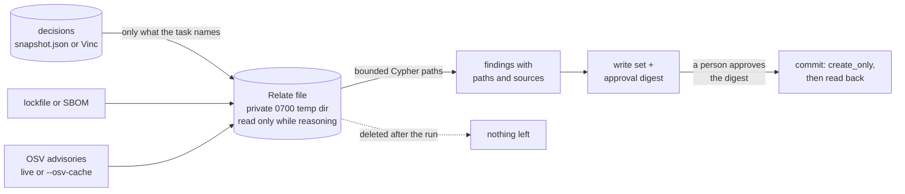

<p align="center">
  
</p>

# decisis

**Check work against the decisions your team already made, in a throwaway graph, offline.**

[](https://github.com/Vinculums/decisis/actions/workflows/test.yml)
[](https://pypi.org/project/decisis/)
[](https://pypi.org/project/decisis/)
[](https://github.com/Vinculums/decisis/blob/main/LICENSE)
[](https://github.com/relatedb/relate)


decisis (from *stare decisis*, "stand by what was decided") is a command-line tool and Python package.
It takes the decisions a task needs, joins them with code paths and outside facts (a lockfile or SBOM and
OSV advisories) in a throwaway [Relate](https://github.com/relatedb/relate) graph, and finds the
multi-hop path from a decision to the thing that breaks it. Every finding carries that path and its
sources. The graph lives in a private temporary directory and is deleted when the task ends.

It needs no account and no model. Decisions come from a plain JSON snapshot that you can write by hand,
or from a [Vinc](https://vincs.io) space if you connect one. Nothing is written back anywhere unless a
person approves the exact write set by its digest.

What it is not, today: a linter that reads your code, a vulnerability scanner for every ecosystem, or a
place to store decisions. It reads the lockfiles and SBOMs listed under [Inventory formats](#inventory-formats), decisions come from a snapshot file or Vinc, and
the benchmark below is small and synthetic. [What is proven, and what is not built yet](#what-is-proven-and-what-is-not-built-yet)
has the full list.

## Install

Python 3.11 or newer on macOS, Linux or Windows (x86-64; arm64 on macOS and Linux).

```bash
pip install decisis
```

As an isolated command-line tool:

```bash
uv tool install decisis      # or: pipx install decisis
```

The install fetches `relate-db` from PyPI once; every command after it runs offline, except `audit`
asking api.osv.dev when you give it no `--osv-cache`. The [npm package](https://www.npmjs.com/package/decisis)
only points here.

## Quick start

**1. Watch the whole procedure on synthetic data** (under a second, writes nothing):

```bash
decisis demo
```

It checks out 3 of 9 nodes from a synthetic team graph, joins them with a lockfile and cached OSV
advisories in a Relate graph (14 nodes, 15 edges), finds the five-hop path below, has a Checker
re-derive each proposed record (31 checks over 7 records), and stops at the write set and its digest:

```
decision:no-high-advisories-in-shipped-dependencies -ABOUT-> concept:demo-app <-DESCRIBED_BY- repo:Demo
  -DEPENDS_ON-> pkg:npm/report-kit@2.1.0 -DEPENDS_ON-> pkg:npm/lodash@4.17.15 -AFFECTED_BY-> adv:GHSA-r5fr-rjxr-66jc
```

The rule lives in the team's decisions, the dependency chain in the lockfile and the advisory in OSV;
no single source holds the connection.

**2. Use your own decisions.** If the repository keeps ADRs (MADR or Nygard), a CODEOWNERS file or
postmortems, build the snapshot from them and ask what governs a file:

```bash
decisis init --repo-dir . --repo Shop --out snapshot.json
decisis impact snapshot.json src/payments/retry.py --repo Shop --format text
```

`init` prints what it could not read and why; [`docs/data-model.md`](https://github.com/Vinculums/decisis/blob/main/docs/data-model.md#a-snapshot-from-a-repository-init)
lists the front matter keys and headings it reads. Or write a snapshot by hand: one JSON file of nodes and edges. This one has an app,
a checkout flow, one decision and one incident record ([`docs/data-model.md`](https://github.com/Vinculums/decisis/blob/main/docs/data-model.md) has
every field):

```json
{
 "nodes": [
  {"id": "concept:shop-web", "kind": "concept", "title": "Shop web app", "props": {"code_ref": "Shop:src/"}},
  {"id": "concept:checkout-flow", "kind": "concept", "title": "Checkout flow", "props": {"code_ref": "Shop:src/checkout/"}},
  {"id": "decision:no-high-advisories-when-shipped", "kind": "decision", "title": "No high advisories in what we ship",
   "props": {"rule": {"advisory_severity_at_least": "HIGH", "dependencies": "shipped"}}},
  {"id": "record:checkout-timeout-october", "kind": "record", "title": "Checkout timed out under load"}
 ],
 "edges": [
  {"source": "decision:no-high-advisories-when-shipped", "target": "concept:shop-web", "type": "ABOUT", "evidence": "applies to the whole app"},
  {"source": "concept:checkout-flow", "target": "concept:shop-web", "type": "RELATED_TO", "evidence": "part of the app"},
  {"source": "record:checkout-timeout-october", "target": "concept:checkout-flow", "type": "RELATED_TO", "evidence": "the timeout was in this flow"}
 ]
}
```

**3. Ask what governs a file before you change it:**

```
$ decisis impact my-snapshot.json src/checkout/pay.py --format text
src/checkout/pay.py: 4 node(s) within 3 hop(s)
  [0] concept  concept:checkout-flow  code_ref Shop:src/checkout/ (encloses)
  [0] concept  concept:shop-web  code_ref Shop:src/ (encloses)
  [1] decision decision:no-high-advisories-when-shipped  via concept:shop-web
        decision:no-high-advisories-when-shipped -ABOUT-> concept:shop-web  (applies to the whole app)
  [1] record   record:checkout-timeout-october  via concept:checkout-flow
        record:checkout-timeout-october -RELATED_TO-> concept:checkout-flow  (the timeout was in this flow)
```

**4. Audit a lockfile against those decisions:**

```bash
decisis audit my-snapshot.json package-lock.json --repo Shop --out report.json
```

`report.json` lists each advisory the repository reaches, the dependency path to it, and the decisions
it breaks. With the demo lockfile and its cached advisories, three findings on shipped `lodash` break the
decision above.

### Inventory formats

`audit` tells the format from the file's content and name:

| Format | File | Development dependencies |
|---|---|---|
| npm lockfile v2 or v3 | `package-lock.json`, `npm-shrinkwrap.json` | `dev` in the lockfile |
| CycloneDX JSON 1.4, 1.5, 1.6 | any name | a component with scope `excluded` or `cdx:npm:package:development` |
| SPDX JSON 2.3 | any name | `DEV_DEPENDENCY_OF`, `TEST_DEPENDENCY_OF`, `BUILD_DEPENDENCY_OF`, `DEV_TOOL_OF` |
| uv | `uv.lock` | dependency groups (`dev-dependencies`) |
| Cargo | `Cargo.lock` | not marked in the lockfile; every crate counts as shipped |
| Go modules | `go.mod`, with `go.sum` in the same directory | not marked; every module counts as shipped |
| Gradle lockfile | `gradle.lockfile`, `settings-gradle.lockfile` | every configuration that locks it is a test, compile-only or annotation processor one |
| Maven POM | `pom.xml` | scope `test` or `provided` |

For Go, pass `go.mod`; `audit` reads the `go.sum` next to it and stops when a required module has no
line there. Each package is queried at OSV under its own ecosystem (npm, PyPI, crates.io, Go, Maven, and for
SBOMs also NuGet, RubyGems, Packagist, GitHub Actions, Debian and Alpine). An SBOM component
without a purl, or whose purl type has no OSV ecosystem, stays in the graph and is listed under
`unresolved_packages` in the report; it is not queried. An inventory with no packages, or none that can
be queried, is refused. `fixtures/inventory/` holds one small example of each format and an OSV cache
that covers them all; the Gradle and Maven examples and their cache are in `fixtures/inventory/jvm/`.

A Gradle lockfile pins every resolved version but not which dependency brings in which, and a `pom.xml`
declares direct dependencies only. `audit` reads `pom.xml` versions that are literals or properties
defined in the same file, and lists a version from a parent, an imported BOM, a range, `LATEST` or
`RELEASE`, or a missing one under `unresolved_packages`. For both formats the report carries `notes`
saying that transitive dependencies are not resolved. For the full graph, generate CycloneDX JSON with
`cyclonedx-gradle-plugin` or `cyclonedx-maven-plugin` and audit that instead; the HTML view shows the
notes above the findings.

## How it works



1. **Check out** only the slice of decisions a task names: a snapshot file, or `checkout` from Vinc.
2. **Load** it with the outside facts into a fresh Relate file in a private directory (under `/dev/shm`
   when it is writable). The loader checks that every node and edge landed.
3. **Reason** read only with bounded Cypher queries (`src/decisis/queries/*.cypher`), so every answer is
   a path you can follow edge by edge.
4. **Propose and approve.** `propose` turns findings into records, re-derives each one in a fresh graph
   built from the snapshot, the lockfile and OSV, holds back any record that fails, and prints the exact
   write set with a digest. Nothing is written until a person passes that digest to `commit`, which
   writes with `create_only` and reads every node and edge back.
5. **Delete** the graph when the task ends.

## Commands

| Command | Needs | What it does |
|---|---|---|
| `demo` | nothing | the whole procedure on synthetic data, against an in-process fake Vinc |
| `init --out <file>` | nothing | a snapshot from the repository's ADRs, CODEOWNERS and postmortems |
| `impact <snapshot> <code path>...` | nothing | the decisions and records that govern a file or directory |
| `paths <snapshot> <from> <to>` | nothing | bounded paths between two ids |
| `audit <snapshot> <lockfile or SBOM> --repo <name>` | the network for api.osv.dev, unless `--osv-cache` | advisories the repository reaches and the decisions they break |
| `propose <report> <snapshot> <lockfile or SBOM> --repo <name> --space <space>` | the network for api.osv.dev, unless `--osv-cache` | re-derives each record, holds back any that fail, and prints the exact write set and its approval digest |
| `compare` | nothing | the benchmark below |
| `checkout <seed>... --out <file>` | a read-only Vinc key | exports a bounded subgraph from Vinc |
| `commit <plan> --approve <digest>` | a full Vinc key | writes an approved write set and reads it back |
| `gc` | nothing | removes task directories that a killed run left behind, and prints them |

Useful flags: `init --repo-dir DIR --repo NAME --adr-dir DIR`, `impact --hops N --format text`, `paths --hops N --limit N`,
`audit --osv-cache FILE --depth N`, `propose --osv-cache FILE --depth N` (give `propose` the same inputs and depth as the audit).

Limits: `paths`, `impact`, `audit` and `propose` refuse a graph over 50,000 nodes or 250,000 edges before writing
anything, and stop any query that runs longer than 60 seconds; the task directory is removed either way
and the command exits with 1. Raise a limit with `--max-nodes`, `--max-edges` or `--query-timeout`, or with
`DECISIS_MAX_NODES`, `DECISIS_MAX_EDGES` or `DECISIS_QUERY_TIMEOUT`, up to 1,000,000 nodes, 5,000,000 edges
and 3,600 seconds. `audit --depth` and `propose --depth` are 1 to 16, `paths --hops` 1 to 6 and `paths --limit`
1 to 100.
`impact`, `paths` and `audit` print JSON (`impact --format text` reads better for people); `demo`, `propose`
and `compare` print text. `decisis <command> --help` lists the rest.

`impact`, `paths` and `audit` also take `--format mermaid` and `--format html`:

- `impact --format mermaid` prints a fenced Mermaid block that GitHub draws: each code path, the nodes
  that name it and the edges to what governs them. `--format html` prints one page with each node, its
  edge path and the evidence on each edge.
- `paths --format mermaid` draws each path between the two ids; `--format html` lists each step with the
  evidence the snapshot gives for its edge, and each node's title and `source` when it has one.
- `audit --format mermaid` draws the dependency paths to each advisory and marks the ones that break a
  decision in red; `--format html` lists each finding with its path, its policies and a link to its OSV
  source. With `--out report.json` the JSON report still goes to that file and the view to stdout.

The HTML page is one file with inline styles only: no scripts, fonts or network requests, so it opens
offline. Its only links are the sources of the findings.

Try them on the fixtures in this repository:

```
decisis paths fixtures/vinc_subgraph.json record:tls-advisory-example concept:service-api
decisis impact fixtures/impact/vinc.json reports/export.py storage/ --format text
decisis audit fixtures/audit/vinc.json fixtures/audit/demo-lockfile.json --repo Demo --osv-cache fixtures/audit/osv-cache.json --out report.json --format html > audit.html
decisis propose report.json fixtures/audit/vinc.json fixtures/audit/demo-lockfile.json --repo Demo --space demo-space --osv-cache fixtures/audit/osv-cache.json --out plan.json
```

## Use it from an AI agent

[`skills/decisis/SKILL.md`](https://github.com/Vinculums/decisis/blob/main/skills/decisis/SKILL.md) is a skill for a coding agent such as Claude Code. It
covers when to reach for `audit`, `impact` or `paths`, how to check out only what the task names, how to
read a finding, and the rule that the agent shows the write set and digest to the person and stops. The
agent never approves its own write. To use it, copy the directory to where your agent loads skills (for
Claude Code, `.claude/skills/decisis/`) and put `decisis` on the agent's `PATH`.

decisis itself calls no language model. The agent is the reasoner that chooses seeds, runs the bounded
queries and explains the paths; the tool gives it a graph it cannot write to, findings that carry their
evidence, and a write path that needs a person's digest.

## Connect Vinc (optional)

```
VINC_API_KEY=<read-only key> VINC_SPACE=<space id> decisis checkout <seed id> ... --out snapshot.json
VINC_API_KEY=<full key> decisis commit plan.json --approve <digest>
```

`VINC_MCP_URL` points at another Vinc server. Without `VINC_SPACE`, `checkout` reads the key's default
space, and the snapshot's `meta.space` says `personal`. Write to a real space only after its owner
approves the printed write set.

## Does the graph help? The measured comparison

```
decisis compare
```

`compare` runs nine tasks from `bench/tasks.json` three ways, offline and without a model:
**A** answers from the Vinc snapshot alone (nodes whose `code_ref` matches the subject, then one hop);
**B** adds the lockfile and the advisories as flat records joined by package name, with the same version
range check and policy rule as C; **C** loads all three into a Relate graph and queries it. The tasks and
their expected findings were committed before the first run. A path or a policy link counts when it
equals an expected one; any other claim is unsupported; a claim is covered when its evidence is a
connected chain of edges that exist in the inputs.

| Method | Path discovery | Policy links | Findings | Unsupported claims | Evidence coverage | Latency (ms, all tasks) |
|---|---|---|---|---|---|---|
| A | 5/13 | 5/17 | 0/5 | 0/10 | 10/10 | 0.2 |
| B | 9/13 | 15/17 | 5/5 | 1/30 | 27/30 | 0.6 |
| C | 13/13 | 17/17 | 5/5 | 0/35 | 35/35 | 85.0 |

Against B, C is better on 2 tasks, the same on 7 and worse on none. It helped where a connection spans
sources: a vulnerable package reached only through a shared transitive dependency, and a decision two
hops from the code it governs. Per-task numbers are in `bench/results.md`, every claim with its
coverage in `bench/results.json`. Latency is the only number that changes between runs; C's includes
building and loading a graph for each task.

Read the numbers with these caveats:

- **B's policy-link score is generous.** On the shared transitive dependency B claims a wrong chain
  (through test-kit, which has its own nested copy), yet both of its policy links on that task still
  count as correct because they name the right decision and advisory. Their evidence chain is the wrong
  one; the coverage column (27/30) is where that shows.
- **"C against B" compares paths, policy links and unsupported claims only.** Findings, coverage and
  latency are not part of that label.
- **The impact rule was fitted after seeing the decoy.** `impact` follows a `RELATED_TO` edge only from a
  concept that names no code of its own. That condition was chosen after the overreach decoy task had
  been run, because edge type and direction alone cannot tell the expected path from the decoy. The
  expected findings were not changed, but the rule is fitted on this benchmark; a held-out set is
  needed to show it generalises.
- **The benchmark is small and synthetic.** Nine hand-built tasks show which kinds of connection need a
  graph, not how often they occur in real repositories.

## What is proven, and what is not built yet

Proven by the tests in `tests/` (run offline in CI on Python 3.11 and 3.12) and by the runs above:

- A Vinc subgraph is exported over the Vinc MCP with stable ids, edge direction and evidence, and a
  snapshot whose counts disagree with its lists is refused.
- The snapshot loads into a Relate file; the loader compares what landed with the snapshot and names a
  repeated id or an edge with a missing endpoint. A bounded multi-hop query returns the expected path.
- Reasoning opens the file read only and a write is refused; an open writer locks out a second writer
  and any reader.
- The task directory is private (0700), under `/dev/shm` when it is writable, and removed after the run.
- A graph over the node or edge cap is refused before anything is written, a query over the time limit
  is stopped, and in both cases the task directory is removed and the command exits non-zero.
- Each task directory records its owner process. On Linux and macOS a new sandbox, or `decisis gc`,
  removes `decisis-*` directories under the same root whose owner is gone; it leaves another user's
  directory, a live run's directory, a `decisis-*` entry that is a symbolic link, and anything a symbolic
  link inside a task directory points to. A root that is itself a symbolic link is followed and used as
  the root.
- The audit joins the snapshot, the lockfile or SBOM (nested npm copies resolved) and OSV, checks the
  installed version against the advisory ranges (semantic versions, and PEP 440 for PyPI), and keeps each
  advisory's source URL, fetch time and content hash.
- `propose` re-derives each record in a fresh graph built from the snapshot, the lockfile and OSV: the
  advisory's content hash and severity, each version as a lockfile package inside the advisory's ranges,
  each dependency path from the repository to the record's own package and advisory, the record's scope
  against the development flags on its paths, and each `relates_to` target as a decision in the snapshot. A record that fails is held back with the failed
  checks, and `propose` exits non-zero. The demo runs the same checks.
- `commit` refuses a digest that does not match the plan as it stands, writes with `create_only`, and
  fails when a node, a property or an edge's type or direction does not come back.
- A live run against a real Vinc space wrote and read back seven records with `create_only`, and a second
  run with the same approval wrote nothing. That space is not public; `decisis demo --approve` is the
  reproducible version.

Future work, not built:

- A Relate MCP server as the agent's read-only query surface; today the agent drives the CLI.
- pnpm, Yarn, Bun, Poetry, requirements.txt, Gradle and Maven inputs, and repository metadata beyond the inventory.
- Removing stale task directories on Windows; there `decisis gc` says so and removes nothing.
- Encrypted scratch storage with key destruction for sensitive data (see `docs/threat-model.md`).
- A held-out benchmark set, and real repositories, to test whether the comparison holds.

## Development

You need Python 3.11 or newer, git and [uv](https://docs.astral.sh/uv/).

```
git clone https://github.com/Vinculums/decisis.git
cd decisis
uv venv .venv && uv pip install --python .venv/bin/python -e ".[dev]"
.venv/bin/python -m pytest -q
.venv/bin/decisis demo
```

Without uv: `python3 -m venv .venv && .venv/bin/pip install -e ".[dev]"`. On Windows the scripts are
under `.venv\Scripts\` instead of `.venv/bin/`. CI runs the tests offline on Python 3.11 and 3.12 and
checks that the built wheel runs `demo` and `compare` outside the repository.

To approve the demo, as the person would:

```
.venv/bin/decisis demo --approve d761d1c8a44d62e2
git diff demo/transcript.json
```

The records go to the fake Vinc with `create_only`, every node and edge is read back, and a new
checkout finds the committed edges with their type and direction. The digest is the same on every
run because the records are dated by the OSV cache. Both runs write `demo/transcript.json`,
`demo/expected_findings.json` and `demo/sample.rl` (a copy of the sandbox graph for inspection, synthetic
data only). The committed copies come from the approved run, so `git diff demo/transcript.json` shows
only its `timestamps` block changed; `sample.rl` is rebuilt, so its bytes differ. The sandbox itself is
deleted.

More in [`docs/architecture.md`](https://github.com/Vinculums/decisis/blob/main/docs/architecture.md) (modules, the sandbox lifecycle, the queries and
the write path), [`docs/data-model.md`](https://github.com/Vinculums/decisis/blob/main/docs/data-model.md) (the snapshot, the Relate graph, the report
and the plan) and [`docs/threat-model.md`](https://github.com/Vinculums/decisis/blob/main/docs/threat-model.md) (what the sandbox protects and what it
does not). `docs/media/make_media.py` redraws the demo recording and the social preview.

## Name and history

The project was called vinc-relate until 2026-11-24. The `vinc-relate` command and `import vinc_relate`
still work until 0.2.0. It is an entry for the Relate by Neo4j hackathon, "Context, Connected".

## License

Apache-2.0. See [`LICENSE`](https://github.com/Vinculums/decisis/blob/main/LICENSE).
