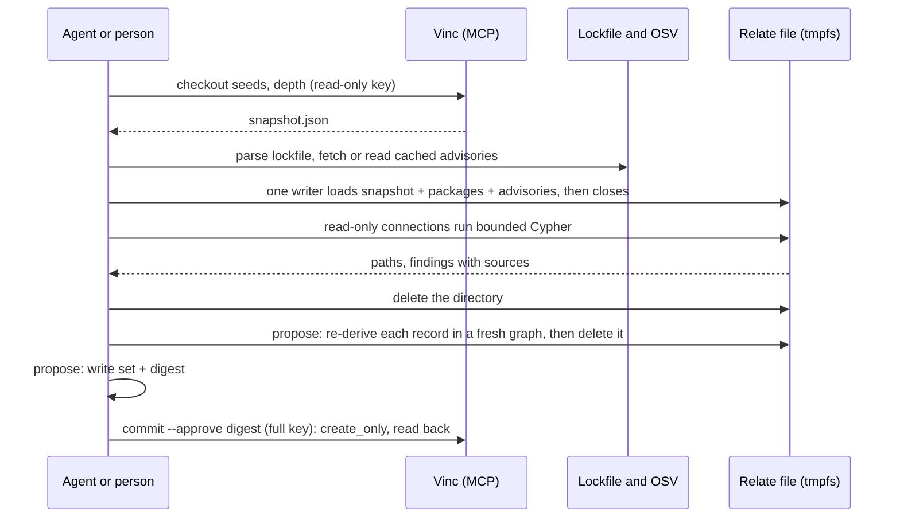

# Architecture

decisis keeps two kinds of memory apart. Vinc is the persistent layer: decisions, concepts, records
and the evidence on their edges, kept across tasks. A Relate file is the ephemeral layer: one task's
slice of Vinc joined with outside data, built for that task, read only while the agent reasons, and
deleted when the task ends. The only way back from the second to the first is a write set a person
approves by its digest.

## Modules

| File | What it does |
|---|---|
| `src/decisis/cli.py` | The `decisis` command and its subcommands: `checkout`, `init`, `paths`, `impact`, `check`, `audit`, `propose`, `commit`, `demo`, `compare`, `gc`, `query` and `serve`. It reads the size and time limits from flags and environment variables and picks the output format. |
| `src/decisis/checkout.py` | `VincMCP`, a small JSON-RPC client for the Vinc MCP endpoint; `checkout` calls `vinc_graph` once per seed and `normalize` merges the results into a `Subgraph` (deduplicated by id, known edge types only, edges with a missing endpoint dropped). `dump` and `load` read and write the snapshot file. |
| `src/decisis/init.py` | `init`: one reader per source (ADRs in MADR or Nygard form, CODEOWNERS, postmortems, and merged pull requests through `github.py`), each returning nodes and edges in snapshot shape, and `build`, which merges and sorts them and lists what it could not read. Front matter is read by a small subset parser; only `rule` and `waivers` may also be YAML, read by `yamltext.plain`. |
| `src/decisis/codeowners.py` | GitHub's CODEOWNERS matching: which line owns each file, and the fewest paths that cover each owner set. |
| `src/decisis/github.py` | A GitHub REST client bound to api.github.com: GET requests for the merged pull requests of `init --github` and for the reviews and comments the action reads; the action's `POST` and `PATCH` of its own comment go through the same client (`action.post`). It refuses a page or a redirect on another host, caps the answer size and the number of items read, and keeps the token out of every message. |
| `src/decisis/sandbox.py` | `Sandbox`: creates the private task directory, loads a `Subgraph` once with a single writer connection, answers queries over read-only connections in a query process with a time limit, and deletes the directory. `sandbox()` is the context manager every command uses. `Limits` holds the size caps and the time limit; `sweep()` removes task directories a killed run left, and `owned_dir` makes the parent directory of `serve`. |
| `src/decisis/inventory/` | One reader per inventory format: `npm.py` (package-lock.json), `pnpm.py`, `yarn.py` (v1 and Berry), `bun.py` (`bun.lock`; refuses `bun.lockb`), `cyclonedx.py`, `spdx.py`, `uv.py`, `poetry.py`, `requirements.py`, `cargo.py`, `gomod.py` (with `go.sum`), `gradle.py`, `pom.py`, `actions.py` (GitHub Actions workflows and `action.yml`) and `terraform.py` (`.terraform.lock.hcl`). Each turns the file into `Repository`, `Workspace` and `Package` nodes and `DEPENDS_ON` edges of the same shape; `inventory.read` tells the format from the content and file name. `js.py` holds what the npm-family readers share, `shape.py` the ids, purls and license ids every reader uses, and `siblings.py` the bounded reader for files next to the inventory. |
| `src/decisis/yamltext.py` | Loads YAML with PyYAML's `BaseLoader` (strings, lists and mappings only) after a scan of its events that caps size and depth and refuses aliases, or with `aliases=True` caps the expanded node count. `plain` also turns whole numbers, `true`, `false` and null into values, keeps every other scalar as text, and refuses tags, repeated keys and a node that holds itself. |
| `src/decisis/external.py` | Fetches OSV advisories with one batch query, each package under its own ecosystem, and one record per advisory, or reads them from an `--osv-cache` file and refuses the network. For GitHub Actions it reads OSV's list of action names to ask under the spelling OSV stores. A record without its own severity takes it from a GHSA alias in the same data or from its CVSS v3 vector (`src/decisis/cvss.py`). `parse_npm_lock` stays importable here. |
| `src/decisis/pep440.py`, `src/decisis/maven.py` | Order PyPI versions by PEP 440 and Maven versions by Maven's rules, for OSV `ECOSYSTEM` ranges. |
| `src/decisis/semver.py` | Checks an installed version against OSV `SEMVER` and `ECOSYSTEM` ranges, ordered the way the package's ecosystem orders versions; a version it cannot order gives `unresolved`. |
| `src/decisis/audit.py` | Composes the snapshot, the inventory and the advisories into one graph, adds `DESCRIBED_BY` from the repository to each Vinc node whose `code_ref` names it and, for a snapshot from `init` of this repository, `RECORDS` from the repository to each decision with a dependency rule, runs the dependency and governance queries, and judges each finding against each governing decision. |
| `src/decisis/rules.py` | Reads a decision's `rule` into rules and problems, and judges one advisory, license, package, changed file or import against one rule; `KINDS` holds one entry per rule kind. |
| `src/decisis/impact.py` | Answers "this code path changes; what governs it": matches `code_ref`, `subject_path` and `also_touches` against the queried paths, keeps only the edges that carry governance (`CARRIES`), orients them from the governing node to the governed one, and walks back from the matching nodes. |
| `src/decisis/cycles.py` | Finds each `SUPERSEDES` cycle among a snapshot's nodes (a strongly connected set, or one node with an edge to itself) that holds a decision, with its members, decisions and ADR files and the reason text `init` and `check` give. |
| `src/decisis/jvm.py` | Reads the imports of a Java or Kotlin file and resolves each to the source file or package directory that holds the class, by `package` line and by path under the source roots (`src/<set>/java`, `src/<set>/kotlin`, and the directories a Gradle script or `pom.xml` declares). |
| `src/decisis/workspaces.py` | Finds the packages of an npm, pnpm, Yarn or Bun workspace and resolves a bare specifier that names one (through `exports`, `main` and `workspace:` links) to its files. |
| `src/decisis/check.py` | `check`: lists the changed files (`--changed`, or `git diff --name-only REF...HEAD` with hooks, fsmonitor and pager off), runs `impact` on them, sets superseded decisions apart, and judges `review_required` and `imports_forbidden` for the files each rule covers. |
| `src/decisis/imports.py` | Reads the imports of a Python file with `ast`, of a JavaScript or TypeScript file with a scanner that skips comments, strings, template literals, regular expressions and JSX text, and of a Go, Rust, Java or Kotlin file with a scanner that skips comments, strings and character literals, then resolves each to a file or directory in the repository (package roots, `tsconfig.json` or `jsconfig.json` `paths` and `baseUrl` with `extends`, the workspace packages of an npm, pnpm, Yarn or Bun workspace, the module path of the nearest `go.mod`, the crate root of the nearest `Cargo.toml` and the other crates of the repository, the source roots and `package` lines of Java and Kotlin files) or marks it external or `unresolved`. A plain text search runs beside the scanner, and a disagreement is `unresolved`. |
| `src/decisis/render.py` | The `mermaid` and `html` views of the `impact`, `check`, `paths` and `audit` reports. Every label is escaped, and the HTML is one file with inline styles and no script; its only links are the findings' sources. |
| `src/decisis/cypher.py` | The `query` command and tool: the text check that refuses writes, loads, admin clauses, `CALL { }` subqueries and procedures other than the schema ones; the `EXPLAIN` plan check on a read-only connection; the row and byte caps; and the schema text built from a snapshot for the tool description. |
| `src/decisis/serve.py` | `serve --mcp`: a stdio MCP server (the optional `mcp` extra) with the tools `impact`, `paths`, `audit`, `check` and `query`. It validates each call against its JSON schema, refuses code paths outside the repository, lockfiles and changed files outside `--root`, and a `check` base that could pass for an option, reloads a changed snapshot before a call, builds and deletes a sandbox per call, and removes its own directory on SIGTERM, SIGINT or the end of stdin. |
| `src/decisis/compact.py` | The `summary` form of each tool reply (counts, ids, titles and the first 10 items of each list) and `fit`, which shortens the longest list until a reply is under 1 MiB and adds a `cut` note. |
| `src/decisis/action.py` | The code behind `action.yml`: reads the pull request from the event payload, the approving reviews through `github.py`, runs `check` and `audit`, and writes or updates one marked comment, falling back to the job summary on a fork or a read-only token. |
| `src/decisis/commit.py` | `propose` turns `affected` findings into record nodes and `relates_to` edges, with a digest over the space, nodes and edges. `commit` checks the digest, writes with `create_only` and an operation id derived from the digest, and reads every node and edge back. |
| `src/decisis/checker.py` | The Checker that `propose` and the demo share: `check_plan` re-derives each record from a loaded sandbox (advisory hash and severity, version, dependency path and scope, decision target and that the decision still governs the repository, by the same `audit.governing` the audit uses; for a license or package record, the package's license expression or name and the decision's rule); it finds each record's package by name and version in the sandbox and checks the version under that package's ecosystem, `withhold` moves a failed record and its edges to `held` and recomputes the digest, and `rederive` builds the fresh sandbox `propose` checks in. |
| `src/decisis/fake_vinc.py` | An in-process stand-in for Vinc's `vinc_node`, `vinc_graph` and `vinc_ingest`, used by the demo and the tests. It stores a record's edge the way Vinc returns it (`ATTACHES_TO` with a role). |
| `src/decisis/demo.py` | The judge demo: the whole procedure against the fake Vinc and the fixtures, with a Checker step (`checker.check_plan`) and a transcript. |
| `src/decisis/compare.py` | The A/B/C benchmark over `bench/tasks.json`, or over another task file such as `bench/holdout/tasks.json` with `--tasks`. |
| `src/decisis/queries/*.cypher` | The Cypher the commands run. Hop and result bounds are substituted as integers; every other value is a query parameter. |
| `action.yml` | The composite GitHub Action: installs decisis into a virtual environment, passes its inputs as environment variables, and runs `python -I -m decisis.action`. |

## The sandbox lifecycle

1. `Sandbox()` first removes stale task directories under the same root (see below). It then makes
   `decisis-<random hex>/` with mode 0700 under `/dev/shm` when that directory exists and is writable,
   otherwise under the system temporary directory, and writes `owner.json` (process id, process start
   time where the platform gives one, host name) into it. The database is `task.rl` inside it.
2. `load()` first compares the snapshot with the node and edge caps and raises `TooLarge` before it
   opens the database. It then opens one writer connection, creates the nodes grouped by kind (the kind becomes the label)
   and the edges grouped by type, counts what landed and closes. A second `load()` on the same sandbox is
   refused. If the counts differ from the snapshot, the error names repeated ids and edges with a missing
   endpoint.
3. `query()` sends the query to a query process, which opens a new connection with `read_only=True`
   for it and closes it after. A write through that connection fails with `WriteOnReadOnly`. Relate
   1.0.2 has no query timeout or interrupt in its Python API, and a signal handler does not run while a
   query is executing, so the time limit is kept by a separate process: when a query runs past the limit,
   the process is killed and `QueryTimeout` is raised. One query process serves every sandbox in a
   command and starts while the graph loads, so the cost is one Python start (about 0.1 s on Linux) per
   command, not per query. The query process exits when the command's process ends.
4. `destroy()` removes the directory. The context manager calls it in a `finally`, so an exception in
   the task, a refused load or a stopped query still removes it.

A directory is stale when its name is exactly `decisis-` or `decisis-serve-` and 32 hex digits (the
second is the parent directory `decisis serve` makes with `owned_dir`, which records its owner the same
way), it is a real directory (not a symbolic link) owned by the current user, it is older than the grace period (10 minutes), its
`owner.json` is a regular file of the same user on the same host, and that process is gone: no process
has the id, or on Linux the process with that id started at another time (the id was reused). A live
process, an unreadable record or a missing record keeps the directory. Removal uses
`shutil.rmtree`, which does not follow symbolic links. Removal needs `os.getuid` and a symlink-safe
`rmtree`, so it runs on Linux and macOS and is skipped on Windows. `decisis gc [--root DIR] [--grace
SECONDS]` runs the same removal on demand.

Relate's single file is locked by an open writer: a second writer and any reader get `storage locked`
until it closes (`tests/test_sandbox.py`). That is why loading and reasoning are separate steps.

## The queries

| Query | Used by | Finds |
|---|---|---|
| `paths_between` | `paths` | Paths of 1 to `--hops` edges in either direction between two ids, shortest first, at most `--limit`. |
| `dependency_paths` | `audit` (and the demo through it), `propose`, `compare` | Every `repo -DEPENDS_ON*-> package -AFFECTED_BY-> advisory` chain up to `--depth` (default 8). |
| `dependency_edges` | `propose` | The `DEPENDS_ON` edges into the packages on license and package records' paths, so the Checker can walk each record path step by step. |
| `governing_decisions` | `audit`, `compare` | Decisions `ABOUT` a Vinc node the repository is `DESCRIBED_BY`. |
| `recorded_decisions` | `audit` | Decisions of an `init` snapshot the repository `RECORDS`. |
| `decision_to_advisory` | `demo` | The shortest path from one decision through the repository and its dependencies to one advisory. |
| `governing_nodes` | `impact` | Decisions and records within `--hops` of a node whose code paths match, over governance edges only. |
| `packages_named`, `package_records` | `propose` | The packages of a record, by name or by id, with their ecosystem, version, `dev` flag and licenses, so the Checker can judge them again. |
| `advisory_records` | `propose` | The advisories of the records, with their content hash, severity and ranges. |

## Findings and verdicts

`audit` takes each dependency chain the query returns and checks the installed version against the
advisory's ranges: `affected`, `not_affected`, or `unresolved` when the version cannot be compared. For
each governing decision it gives a verdict: a decision with a machine-checkable `rule`
(`advisory_severity_at_least`, optionally `dependencies: shipped`) is `violated` or `not_violated`, one
without a rule is `relevant`. A dependency reached only through development dependencies does not
violate a rule about shipped ones. The verdict is computed in Python from the graph's answers, not by the
query.

Decisions can also forbid licenses and packages (`license_denied`, `license_allowed`, `package_denied`), allow only listed packages (`package_allowed`) and require every GitHub action to be pinned to a commit (`pinned_to_commit`).
When a governing decision has such a rule, `audit` judges every package in the graph against it and adds
a license or package finding for each package a rule matches or cannot judge, with the shortest
dependency path to it. That path comes from a breadth-first search over the composed graph's `DEPENDS_ON`
edges up to `--depth`, not from a query: it keeps at most two paths per package, the shortest and the
shortest with no development package on it, and lists no others. `src/decisis/rules.py` reads rules and judges one package or advisory; each kind is
one entry of its `KINDS` table. A rule that cannot be read is `relevant` with its reason, never `violated`.
The format is in [the data model](data-model.md#rules).

## Checking a change

`check` reads no inventory and no advisories. It takes the changed files from `--changed`, or from
`git diff --name-only REF...HEAD` in `--repo-dir` with the repository's hooks, fsmonitor and pager turned
off; a ref that looks like an option is refused. It runs `impact` on those files to list the governing
decisions. It then judges the `review` and `import` kinds of every decision in the snapshot on the changed
files its globs cover, except a decision that a `SUPERSEDES` edge replaces, which is listed apart and not
judged. A decision in a `SUPERSEDES` cycle is not replaced by it: `impact.superseded_by` leaves each member of a cycle
out (`cycles.py`), and `check` lists the cycle as a result that cannot be judged. `review_required` compares the rule's handles with
`--reviewers`. `imports_forbidden` reads the imports of each changed file its `from` globs cover
(`imports.py`) and judges each resolved target against the `to` globs. Repository code is parsed and never
run. An import that cannot be resolved is `unresolved`; `--fail-on-unresolved` turns those into a failure.
The exit code is 1 on a violation. The report is in [the data model](data-model.md#the-check-report).

## The write path

`propose` writes nothing; it produces a plan file and prints it. Only `affected` findings become records;
the rest are listed under `held`. Each record carries the advisory's source URL, fetch time and content
hash, the dependency paths, and the decisions it violates.

`commit` needs the digest. It recomputes the digest from the plan file and refuses when either differs,
so an edited plan needs a new approval. It skips ids that already exist, writes the rest with
`create_only` and an operation id derived from the digest, then reads each new node back and compares
every property, and checks out each record again to confirm each edge with its type and direction. Any
difference makes the exit code non-zero and is listed under `problems`.

Before it prints the digest, `propose` runs a Checker. It builds a fresh sandbox from the snapshot, the
lockfile and OSV (or `--osv-cache`), and for each record compares the advisory hash and severity with the
OSV record in that graph; checks that each version is a package of that name in the lockfile, inside the
advisory's ranges and reached by one of the record's paths; checks that each dependency path runs from the
repository to the record's own package and advisory, exists in the graph, and has development flags that
match the record's scope; and confirms each decision the record names under `violates` or `waived`, or links with `relates_to`, is a decision in the snapshot that
governs the repository there, by the same `audit.governing` the audit judges with (a superseded decision, a decision with no link to the
repository and another repository's `init` decision do not). A record that fails any check is left out with its
edges and listed under `held` with the failed checks, the digest covers only what is left, and `propose`
exits non-zero. The demo runs the same `checker.check_plan` in its own sandbox.

## The MCP server and `query`

`serve --mcp` fixes a snapshot file, an optional OSV cache and a `--root` when it starts. It makes one
private `decisis-serve-<32 hex>` directory with an owner record, and every tool call loads the snapshot
into a new sandbox inside it and deletes that sandbox before the reply. Before each call `serve.Live`
compares the file's mtime and size with the copy it holds and reloads it when either changed; a file that
fails to load leaves the previous copy, and the reply carries `reload_failed`. After a reload the `query`
schema is rebuilt and the server sends `notifications/tools/list_changed`. The tools are `impact`, `paths`,
`audit`, `check` and `query`; each validates its arguments against a JSON schema with the same bounds as the
command, and a refused argument comes back as an error result. Replies are the command's report in
`"detail": "full"`, or in the default `"summary"` a short form from `compact.py`; either way `compact.fit`
keeps the reply under 1 MiB.

`query` runs in three steps, and any one of them refuses a write on its own. `cypher.py` checks the text
first: one statement, starting with `MATCH`, `OPTIONAL MATCH`, `WITH`, `UNWIND`, `RETURN` or `CALL`, with no
write, load or admin clause after comments are removed and outside strings and backticked names, no
`CALL { }` subquery, and only the schema procedures. The query process then plans the statement with
`EXPLAIN` on a read-only connection and runs it only when Relate plans it as a read. The read-only
connection refuses any write that got past both. Rows stop at 500 and 1 MiB. The tool description carries
the snapshot's schema, built and escaped by `cypher.describe` when the server starts.

## The GitHub Action

`action.yml` is a composite action. It installs decisis into a virtual environment under the runner's
temporary directory, from the action's own checkout or from PyPI with `decisis-version`, and runs
`python -I -m decisis.action`, so a module in the pull request's checkout cannot shadow decisis. Every input
reaches Python as an environment variable. `action.py` reads the base and head commits from the event
payload, runs `check` on `git diff BASE...HEAD` with the users whose latest review approves as the reviewers, runs `audit`
when an inventory is given, and writes one comment marked `<!-- decisis -->`: it updates the comment of
`comment-author` that carries the marker, or creates one. On a fork, or when the token cannot write, the
result goes to the job summary only. The comment is kept under GitHub's 65,536-character limit by leaving
out the graph first and then cutting the lists, and it says what was cut.

## The comparison

`compare` gives B and C the same lockfile parsing, version check and policy rule, so only the join
differs: A is the snapshot with a one-hop neighbourhood and no outside data, B joins flat records by
package name, C is the Relate graph. Each task in `bench/tasks.json` lists its expected paths, policy links and findings,
which were committed before the first run.

`bench/holdout/tasks.json` is a held-out set of 30 tasks (20 impact, 10 audit) on five open-source
repositories at pinned commits, with snapshots built by `init` and a hand-made mapping from each ADR to the
paths its text names (`bench/holdout/SOURCES.md` has the sources and licenses). `decisis compare --tasks
bench/holdout/tasks.json` runs it from a checkout of this repository; the held-out inputs are not in the
wheel. The committed results are `bench/results.json` and `bench/holdout/results.json`, with their
tables in the `results.md` next to each; a slow test checks that the command still gives the held-out
results. [benchmark.md](benchmark.md) gives the numbers and their caveats.
