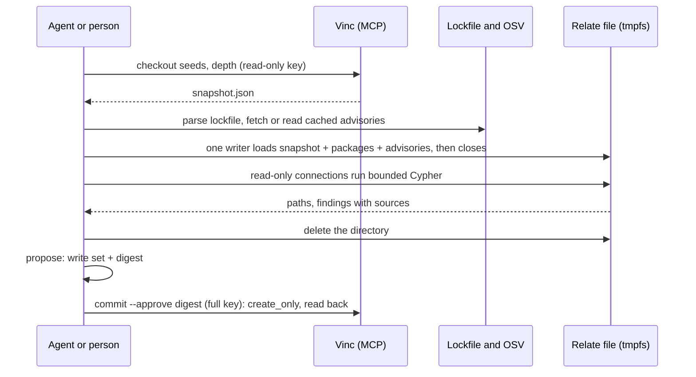

# Architecture

decisis keeps two kinds of memory apart. Vinc is the persistent layer: decisions, concepts, records
and the evidence on their edges, kept across tasks. A Relate file is the ephemeral layer: one task's
slice of Vinc joined with outside data, built for that task, read only while the agent reasons, and
deleted when the task ends. The only way back from the second to the first is a write set a person
approves by its digest.

## Modules

| File | What it does |
|---|---|
| `src/decisis/cli.py` | The `decisis` command: `checkout`, `paths`, `impact`, `audit`, `propose`, `commit`, `demo`, `compare`. |
| `src/decisis/checkout.py` | `VincMCP`, a small JSON-RPC client for the Vinc MCP endpoint; `checkout` calls `vinc_graph` once per seed and `normalize` merges the results into a `Subgraph` (deduplicated by id, known edge types only, edges with a missing endpoint dropped). `dump` and `load` read and write the snapshot file. |
| `src/decisis/sandbox.py` | `Sandbox`: creates the private task directory, loads a `Subgraph` once with a single writer connection, answers queries over read-only connections, and deletes the directory. `sandbox()` is the context manager every command uses. |
| `src/decisis/external.py` | Parses an npm lockfile (v2 or v3) into `Repository` and `Package` nodes and `DEPENDS_ON` edges, resolving nested `node_modules` copies the way npm does. Fetches OSV advisories with one batch query and one record per advisory, or reads them from an `--osv-cache` file and refuses the network. |
| `src/decisis/semver.py` | Checks an installed version against OSV `SEMVER` and `ECOSYSTEM` ranges. |
| `src/decisis/audit.py` | Composes the snapshot, the lockfile and the advisories into one graph, adds `DESCRIBED_BY` from the repository to each Vinc node whose `code_ref` names it, runs the dependency and governance queries, and judges each finding against each governing decision. |
| `src/decisis/impact.py` | Answers "this code path changes; what governs it": matches `code_ref`, `subject_path` and `also_touches` against the queried paths, keeps only the edges that carry governance (`CARRIES`), orients them from the governing node to the governed one, and walks back from the matching nodes. |
| `src/decisis/commit.py` | `propose` turns `affected` findings into record nodes and `relates_to` edges, with a digest over the space, nodes and edges. `commit` checks the digest, writes with `create_only` and an operation id derived from the digest, and reads every node and edge back. |
| `src/decisis/fake_vinc.py` | An in-process stand-in for Vinc's `vinc_node`, `vinc_graph` and `vinc_ingest`, used by the demo and the tests. It stores a record's edge the way Vinc returns it (`ATTACHES_TO` with a role). |
| `src/decisis/demo.py` | The judge demo: the whole procedure against the fake Vinc and the fixtures, with a Checker step (`check_plan`) and a transcript. |
| `src/decisis/compare.py` | The A/B/C benchmark over `bench/tasks.json`. |
| `src/decisis/queries/*.cypher` | The Cypher the commands run. Hop and result bounds are substituted as integers; every other value is a query parameter. |

## The sandbox lifecycle

1. `Sandbox()` makes `decisis-<random hex>/` with mode 0700 under `/dev/shm` when that directory
   exists and is writable, otherwise under the system temporary directory. The database is `task.rl`
   inside it.
2. `load()` opens one writer connection, creates the nodes grouped by kind (the kind becomes the label)
   and the edges grouped by type, counts what landed and closes. A second `load()` on the same sandbox is
   refused. If the counts differ from the snapshot, the error names repeated ids and edges with a missing
   endpoint.
3. `query()` opens a new connection with `read_only=True` for each query and closes it after. A write
   through that connection fails with `WriteOnReadOnly`.
4. `destroy()` removes the directory. The context manager calls it in a `finally`, so an exception in
   the task still removes it.

Relate's single file is locked by an open writer: a second writer and any reader get `storage locked`
until it closes (`tests/test_sandbox.py`). That is why loading and reasoning are separate steps.

## The queries

| Query | Used by | Finds |
|---|---|---|
| `paths_between` | `paths` | Paths of 1 to `--hops` edges in either direction between two ids, shortest first, at most `--limit`. |
| `dependency_paths` | `audit`, `demo` | Every `repo -DEPENDS_ON*-> package -AFFECTED_BY-> advisory` chain up to `--depth` (default 8). |
| `governing_decisions` | `audit` | Decisions `ABOUT` a Vinc node the repository is `DESCRIBED_BY`. |
| `decision_to_advisory` | `demo` | The shortest path from one decision through the repository and its dependencies to one advisory. |
| `governing_nodes` | `impact` | Decisions and records within `--hops` of a node whose code paths match, over governance edges only. |

## Findings and verdicts

`audit` takes each dependency chain the query returns and checks the installed version against the
advisory's ranges: `affected`, `not_affected`, or `unresolved` when the version cannot be compared. For
each governing decision it gives a verdict: a decision with a machine-checkable `rule`
(`advisory_severity_at_least`, optionally `dependencies: shipped`) is `violated` or `not_violated`, one
without a rule is `relevant`. A dependency reached only through development dependencies does not
violate a rule about shipped ones. The verdict is computed in Python from the graph's answers, not by the
query.

## The write path

`propose` writes nothing; it produces a plan file and prints it. Only `affected` findings become records;
the rest are listed under `held`. Each record carries the advisory's source URL, fetch time and content
hash, the dependency paths, and the decisions it violates.

`commit` needs the digest. It recomputes the digest from the plan file and refuses when either differs,
so an edited plan needs a new approval. It skips ids that already exist, writes the rest with
`create_only` and an operation id derived from the digest, then reads each new node back and compares
every property, and checks out each record again to confirm each edge with its type and direction. Any
difference makes the exit code non-zero and is listed under `problems`.

In the demo a Checker runs between `propose` and approval: for each record it compares the advisory hash
with the cached OSV record, checks each version against the advisory's ranges, finds each dependency
path in the sandbox, and confirms each linked decision is in the checkout. The `propose` command for real
data does not run that step yet.

## The comparison

`compare` gives B and C the same lockfile parsing, version check and policy rule, so only the join
differs: A is the snapshot with a one-hop neighbourhood and no outside data, B joins flat records by
package name, C is the Relate graph. Each task in `bench/tasks.json` lists its expected paths, policy links and findings,
which were committed before the first run. The README gives the numbers and their caveats.
